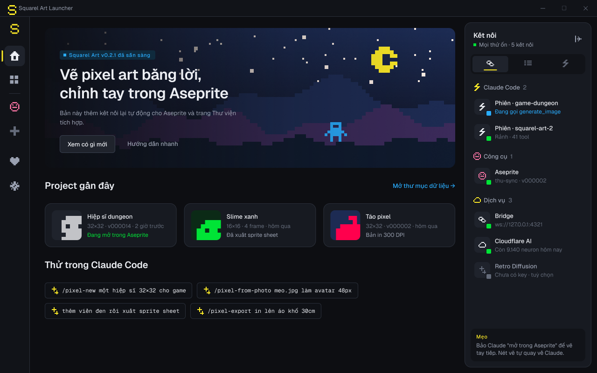

<div align="center">

# Squarel Art

**話しかけて作るピクセルアート。** Claude Code とチャットしながら、本格的なピクセルアートの作成・編集・書き出しを行い、仕上げは Aseprite で手描きできます。両者は常に同期されます。

[](https://github.com/t1tc01-personal/squarel-art-2/actions/workflows/ci.yml)
[](https://github.com/t1tc01-personal/squarel-art-2/releases)
[](LICENSE.md)


[English](README.md) · [Tiếng Việt](README.vi.md) · **日本語** · [简体中文](README.zh-CN.md) · [한국어](README.ko.md)



</div>

## Squarel の特長

- **Claude Code 向けの 40 以上の MCP ツール。** ピクセルを直接描画できるほか、再配色、アウトライン、パレット、減色、背景除去、反転、回転、トリミング、拡大縮小といった、無料で結果が決まる処理を利用できます。写真のピクセルアート化や、AI による生成・編集・アニメーションにも対応しています。
- **いつでも本物のピクセルアート。** AI が生成したすべての画像は、ピクセル正規化パイプラインを通ります。グリッド検出 → セルごとの最頻色 → OKLab でのパレットスナップ → 背景の透過、という流れです。
- **AI があなたの作品を上書きすることはありません。** AI の結果は番号付きの提案として届き、選んだバリエーションだけが新しいレイヤーとして追加されます。すべての操作はバージョン管理され、元に戻せます。
- **Aseprite との双方向ライブ同期。** Claude の編集は Aseprite 上で 1 回の取り消し操作としてまとまって反映され、あなたの描いたストロークは 0.5 秒以内に戻ってきます。同時に編集してもストロークを失わずにマージされます。
- **そのまま使える書き出し。** Aseprite 形式の JSON 付きスプライトシート、GIF、300 DPI の印刷用 PNG、SVG、PDF、アバター、絵文字、WebP ステッカー、ビーズ数やペグボード分割付きの Perler/Hama ビーズパターンに対応しています。
- **コストを抑えられます。** チャットはお使いの Claude プランで動作します。AI 画像は、既定で Cloudflare Workers AI の無料枠、お手元の GPU、またはオフラインの `mock` を使います。有料の Retro Diffusion は、必ず先に料金を提示し、あなたの承認を待ってから実行し、1 日あたりの上限も守ります。

## クイックスタート

### オプション A: Windows ランチャー（ターミナル不要）

1. [Releases](https://github.com/t1tc01-personal/squarel-art-2/releases) から `Squarel-Art-Launcher-Setup-X.Y.Z.exe` をダウンロードします。
2. 実行します。インストーラーはまだコード署名されていません。SmartScreen に止められた場合は、**詳細情報 → 実行** を選んでください。
3. 4 ステップのセットアップに従います。Git/Node/pnpm のインストール（`winget` を使い、表示されるウィンドウ上で、すべての確認にご自身で答えます）、Squarel の取得、`.env` の入力、Claude Code への登録です。

その後はランチャーがブリッジを常時稼働させ、接続中の Aseprite と Claude Code のセッションを表示し、Aseprite の起動、ヘルスチェック、GitHub Releases からの一括アップデートを行います。詳しくは [docs/launcher.md](docs/launcher.md) をご覧ください。

### オプション B: ソースから

必要なもの: Node.js ≥ 22.18（Node 24 で動作確認済み）、pnpm、Claude Code。任意: Aseprite 1.3 以上、Cloudflare アカウント、Retro Diffusion のキー、[services/local-sd](services/local-sd/README.md) 用の Python と NVIDIA GPU。

```powershell
git clone https://github.com/t1tc01-personal/squarel-art-2.git
cd squarel-art-2
pnpm install
Copy-Item .env.example .env   # その後 .env を編集
pnpm check
```

| 変数 | 説明 |
|---|---|
| `DATA_DIR` | プロジェクトの保存先。OneDrive や Google Drive のフォルダを指定すると、バックアップが自動で取れます |
| `IMAGE_PROVIDER` | `cloudflare`（既定）、`local-sd`、または `mock`（オフライン、お試し用） |
| `CLOUDFLARE_ACCOUNT_ID`, `CLOUDFLARE_API_TOKEN` | Cloudflare ダッシュボード → AI → Workers AI → *Use REST API*。トークンには Workers AI へのアクセス権が必要です |
| `RETRO_DIFFUSION_API_KEY` | 任意。`quality: "high"` のときだけ使われます |
| `IMAGE_DAILY_BUDGET_USD` | 有料画像の 1 日あたりの上限（既定は 1） |
| `ASEPRITE_PATH` | `Aseprite.exe` へのパス |

詳しい手順（Cloudflare のキー、Aseprite のビルド、トラブルシューティング）は [docs/setup.md](docs/setup.md) にあります。

## Claude Code での使い方

**このリポジトリで** Claude Code を開いてください。`.mcp.json` に `squarel` サーバーがすでに宣言されており、Claude Code が一度だけ許可するかどうかを尋ねます。`.claude/skills/` にあるスキルが、Claude に作業の流れを教えます。次のように話しかけてみてください。

- `/pixel-new ゲーム用の 32×32 の騎士、PICO-8 パレットで`
- 「黒いアウトラインを付けて」「シャツを青くして」「8 色に減色して」「元に戻して」
- `/pixel-from-photo cat.jpg を 48px のアバターにして`（写真は `DATA_DIR\inbox` に置いてください）
- `/pixel-export 30 cm の T シャツにプリントする用`、または「Hama ビーズのパターンを書き出して」

任意のプロジェクトからこのサーバーを使うには、次のコマンドを実行します。

```powershell
claude mcp add squarel --scope user -- node <repo>\src\mcp\index.ts
```

## Aseprite で手描きする

```powershell
pnpm aseprite:pack   # squarel.aseprite-extension をビルドします。ダブルクリックでインストールできます
```

Claude Code がブリッジを `ws://127.0.0.1:4321/bridge` で起動します。Claude Code を開かずに描きたい場合は `pnpm bridge` を実行してください。Aseprite では **File → Squarel → Open project…** を選ぶか、Claude に「Aseprite で開いて」と頼むだけです。Aseprite をお持ちでない場合は、`pnpm aseprite:build` で個人利用向けにソースからビルドできます（Aseprite の EULA により、そのビルドを再配布することは禁止されています）。詳細: [docs/aseprite.md](docs/aseprite.md)

## Squarel と Aseprite MCP サーバーの違い

[diivi/aseprite-mcp](https://github.com/diivi/aseprite-mcp) や [willibrandon/pixel-mcp](https://pkg.go.dev/github.com/willibrandon/pixel-mcp) などのコミュニティ製 MCP サーバーは、**Claude に Aseprite を操作させる**ものです。Squarel は **アイデアから完成ファイルまでの全工程** を担い、Aseprite は手描きするための場所という位置づけです。

| | Aseprite MCP | Squarel |
|---|---|---|
| 画像の作り方 | Claude が座標を指定してピクセルを置く | 本物のピクセルグリッドとパレットにスナップした AI ドラフト。写真 → ピクセルアート |
| 作品の安全性 | Claude がファイルを直接編集する | 提案のみ。選んだバリエーションが新しいレイヤーになる。完全なバージョン履歴 |
| 共同編集 | お互いに上書きしやすい | ストローク単位のマージによる双方向ライブ同期 |
| 書き出し | Aseprite が書き出せるもの | さらに、印刷用 PNG、SVG、PDF、ビーズパターン、ステッカー |
| Aseprite なしで | 動作しない | Claude Code または CLI だけで動作する |

**Squarel が劣る点:** インデックスカラーのみ（256 色以下）、キャンバスは 256×256 以下、グループレイヤー、タイルマップ、タグ、スライス、ブレンドモードは非対応です。Claude に Aseprite を自動操作させたいだけなら、Aseprite MCP のほうがシンプルです。両者を併用することもできます。

## ドキュメント

詳細なドキュメントは、現在ベトナム語のみで書かれています。

| トピック | リンク |
|---|---|
| セットアップ手順 | [docs/setup.md](docs/setup.md) |
| ランチャー | [docs/launcher.md](docs/launcher.md) |
| アーキテクチャ | [docs/architecture.md](docs/architecture.md) |
| ツールリファレンス | [docs/tools.md](docs/tools.md) |
| Aseprite 同期 | [docs/aseprite.md](docs/aseprite.md) |
| 画像プロバイダー | [docs/providers.md](docs/providers.md) |
| ピクセル正規化 | [docs/pixel-pipeline.md](docs/pixel-pipeline.md) |
| 書き出しプリセット | [docs/export-presets.md](docs/export-presets.md) |
| 連携の作り方 | [docs/integrations.md](docs/integrations.md) |
| ビルドとリリース | [docs/release.md](docs/release.md) |

## プロジェクト構成

```
src/core        ピクセルアルゴリズム（純粋な TypeScript、I/O なし）
src/store       ファイルベースのプロジェクト、バージョン、提案（プロセス間ロック付き）
src/providers   Cloudflare · Retro Diffusion · local-sd · mock、ルーターと予算管理
src/tools       MCP・CLI・ブリッジで共有する約 41 のツール
src/mcp         MCP stdio サーバー
src/bridge      Aseprite 向けの WebSocket ブリッジとファイルウォッチャー
src/cli         コマンドラインインターフェース
launcher/       Windows ランチャー（Electron）
integrations/   Aseprite Lua 拡張と連携マニフェスト
services/       任意のローカル Stable Diffusion サービス（Python）
.claude/skills  Claude Code のスキル
```

## 開発

| コマンド | 内容 |
|---|---|
| `pnpm check` | 型チェック + lint（Biome）+ テスト（Vitest） |
| `pnpm --dir launcher check` | ランチャーに対する同様のチェック |
| `pnpm --dir launcher build` の後に `pnpm --dir launcher e2e` | ランチャーのエンドツーエンドテスト（Playwright） |
| `pnpm mcp` / `pnpm bridge` / `pnpm cli tools` | MCP サーバー、ブリッジ、CLI を手動で実行 |
| `pnpm eval -- --provider mock` | AI 画像の品質を評価（実際のプロバイダーでは `--yes` が必要） |
| `pnpm docs:tools` | [docs/tools.md](docs/tools.md) を再生成 |

## コントリビュート

Issue や Pull Request を歓迎します。まず [CONTRIBUTING.md](CONTRIBUTING.md) をお読みください。セキュリティ上の問題は、[SECURITY.md](SECURITY.md) の手順に従って非公開で報告してください。変更履歴は [CHANGELOG.md](CHANGELOG.md) にまとめています。

## ライセンス

Squarel Art は [PolyForm Shield 1.0.0](LICENSE.md) ライセンスのもとで公開されている **ソース利用可能（source-available）** ソフトウェアです。

- **できること:** 無料で利用できます（個人利用、仕事での利用、企業での利用）。作ったもの（ゲームのスプライト、プリントした T シャツ、ステッカーなど）を販売することも、改変することも、ライセンスを添付したうえで共有することもできます。
- **できないこと:** このコードを使って、Squarel Art と **競合する** 製品を、有償・無償を問わず構築または提供することはできません（例: 名前を変えて再公開する、このコードをもとに AI ピクセルアートのサービスを運営する、など）。

サードパーティのライブラリには、それぞれのライセンスが適用されます。Aseprite は独自の EULA の対象です。この要約は法的助言ではありません。拘束力を持つのは [LICENSE.md](LICENSE.md) の本文です。
