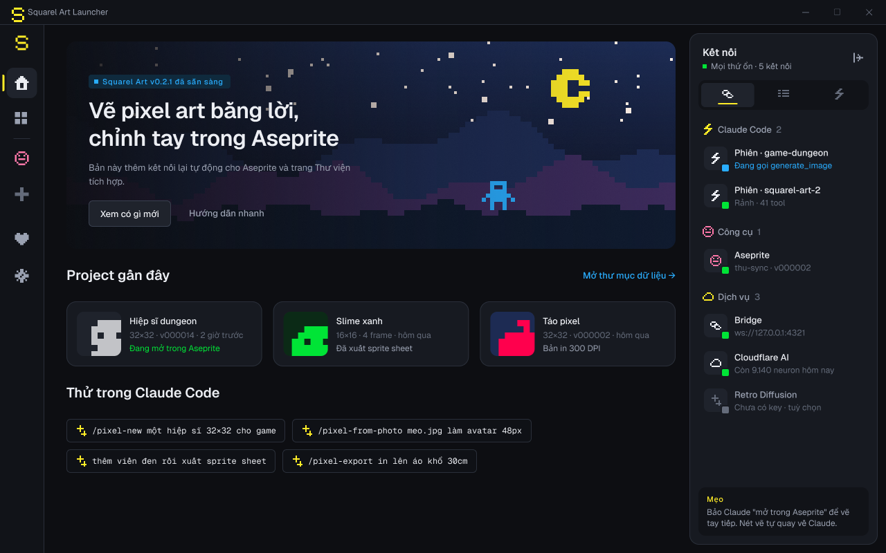

<div align="center">

# Squarel Art

**대화로 만드는 픽셀 아트.** Claude Code와 대화하며 진짜 픽셀 아트를 만들고, 편집하고, 내보낸 다음 Aseprite에서 직접 마무리하세요. 양쪽은 항상 동기화됩니다.

[](https://github.com/t1tc01-personal/squarel-art-2/actions/workflows/ci.yml)
[](https://github.com/t1tc01-personal/squarel-art-2/releases)
[](LICENSE.md)


[English](README.md) · [Tiếng Việt](README.vi.md) · [日本語](README.ja.md) · [简体中文](README.zh-CN.md) · **한국어**



</div>

## Squarel을 쓰는 이유

- **Claude Code용 MCP 도구 40개 이상.** 픽셀을 직접 그리거나, 비용이 들지 않는 결정적(deterministic) 작업을 사용할 수 있습니다. 색상 변경, 외곽선, 팔레트, 색상 수 줄이기, 배경 제거, 뒤집기, 회전, 자르기, 크기 조절이 가능합니다. 사진을 픽셀 아트로 변환하고, AI로 생성·편집·애니메이션까지 할 수 있습니다.
- **언제나 진짜 픽셀 아트.** 모든 AI 이미지는 픽셀 정규화 단계를 거칩니다. 그리드 감지 → 셀별 최빈 색상 → OKLab 기반 팔레트 스냅 → 투명 배경 순서입니다.
- **AI가 작업물을 덮어쓰지 않습니다.** AI 결과는 번호가 매겨진 제안으로 도착합니다. 선택한 변형만 새 레이어로 추가됩니다. 모든 단계는 버전으로 기록되며 실행 취소할 수 있습니다.
- **Aseprite와 양방향 실시간 동기화.** Claude의 편집은 Aseprite에서 하나의 실행 취소 단계로 나타나고, 직접 그린 획은 0.5초 안에 반영됩니다. 동시에 편집해도 획을 잃지 않고 병합됩니다.
- **바로 쓸 수 있는 내보내기.** Aseprite 스타일 JSON이 포함된 스프라이트 시트, GIF, 300 DPI 인쇄용 PNG, SVG, PDF, 아바타, 이모지, WebP 스티커, 비즈 개수와 페그보드 분할이 포함된 Perler/Hama 비즈 패턴을 지원합니다.
- **비용을 통제할 수 있습니다.** 채팅은 사용 중인 Claude 요금제로 동작합니다. AI 이미지는 기본적으로 Cloudflare Workers AI 무료 티어, 내 GPU, 또는 오프라인 `mock`을 사용합니다. 유료인 Retro Diffusion은 항상 가격을 먼저 안내하고, 승인을 기다리며, 일일 한도를 지킵니다.

## 빠른 시작

### 옵션 A: Windows 런처 (터미널 불필요)

1. [Releases](https://github.com/t1tc01-personal/squarel-art-2/releases)에서 `Squarel-Art-Launcher-Setup-X.Y.Z.exe`를 다운로드합니다.
2. 실행합니다. 설치 프로그램은 아직 코드 서명이 되어 있지 않습니다. SmartScreen이 막으면 **추가 정보 → 실행**을 선택하세요.
3. 4단계 설정을 따라 진행합니다. Git/Node/pnpm 설치(`winget` 사용, 모든 안내에 직접 응답할 수 있도록 창이 표시됩니다), Squarel 받기, `.env` 입력, Claude Code에 등록 순서입니다.

이후 런처가 브리지를 계속 실행하고, 연결된 Aseprite와 Claude Code 세션을 보여 주며, Aseprite 실행, 상태 점검, GitHub Releases를 통한 전체 업데이트를 맡습니다. [docs/launcher.md](docs/launcher.md)를 참고하세요.

### 옵션 B: 소스에서 설치

요구 사항: Node.js ≥ 22.18 (Node 24에서 테스트됨), pnpm, Claude Code. 선택 사항: Aseprite 1.3+, Cloudflare 계정, Retro Diffusion 키, [services/local-sd](services/local-sd/README.md)용 Python + NVIDIA GPU.

```powershell
git clone https://github.com/t1tc01-personal/squarel-art-2.git
cd squarel-art-2
pnpm install
Copy-Item .env.example .env   # 그런 다음 .env 편집
pnpm check
```

| 변수 | 의미 |
|---|---|
| `DATA_DIR` | 프로젝트가 저장되는 위치. OneDrive나 Google Drive 폴더를 지정하면 백업이 공짜입니다 |
| `IMAGE_PROVIDER` | `cloudflare`(기본값), `local-sd`, 또는 `mock`(오프라인, 체험용) |
| `CLOUDFLARE_ACCOUNT_ID`, `CLOUDFLARE_API_TOKEN` | Cloudflare 대시보드 → AI → Workers AI → *Use REST API*. 토큰에는 Workers AI 접근 권한이 필요합니다 |
| `RETRO_DIFFUSION_API_KEY` | 선택 사항. `quality: "high"`에만 사용됩니다 |
| `IMAGE_DAILY_BUDGET_USD` | 유료 이미지의 일일 한도 (기본값 1) |
| `ASEPRITE_PATH` | `Aseprite.exe` 경로 |

전체 단계별 가이드(Cloudflare 키, Aseprite 빌드, 문제 해결)는 [docs/setup.md](docs/setup.md)에 있습니다.

## Claude Code와 함께 사용하기

**이 저장소에서** Claude Code를 여세요. `.mcp.json`에 `squarel` 서버가 이미 선언되어 있으며, Claude Code가 허용 여부를 한 번 묻습니다. `.claude/skills/`의 스킬이 Claude에게 작업 흐름을 알려 줍니다. 이렇게 말해 보세요.

- `/pixel-new 게임용 32×32 기사 캐릭터, PICO-8 팔레트로`
- "검은 외곽선 추가해 줘", "셔츠를 파란색으로 바꿔 줘", "8색으로 줄여 줘", "실행 취소"
- `/pixel-from-photo cat.jpg를 48px 아바타로` (사진은 `DATA_DIR\inbox`에 넣어 두세요)
- `/pixel-export 30cm 티셔츠에 인쇄할 파일로`, 또는 "Hama 비즈 패턴으로 내보내 줘"

어떤 프로젝트에서든 이 서버를 사용하려면 다음을 실행하세요.

```powershell
claude mcp add squarel --scope user -- node <repo>\src\mcp\index.ts
```

## Aseprite에서 직접 그리기

```powershell
pnpm aseprite:pack   # squarel.aseprite-extension을 빌드합니다. 더블클릭하면 설치됩니다
```

Claude Code가 `ws://127.0.0.1:4321/bridge`에서 브리지를 시작합니다. Claude Code 없이 그리려면 `pnpm bridge`를 실행하세요. Aseprite에서 **File → Squarel → Open project…**를 사용하거나, Claude에게 "Aseprite에서 열어 줘"라고 부탁하면 됩니다. Aseprite가 없다면 `pnpm aseprite:build`로 소스에서 개인용으로 빌드할 수 있습니다(Aseprite EULA는 해당 빌드의 재배포를 금지합니다). 자세한 내용: [docs/aseprite.md](docs/aseprite.md).

## Squarel과 Aseprite MCP 서버 비교

[diivi/aseprite-mcp](https://github.com/diivi/aseprite-mcp), [willibrandon/pixel-mcp](https://pkg.go.dev/github.com/willibrandon/pixel-mcp) 같은 커뮤니티 MCP 서버는 **Claude가 Aseprite를 조작**하게 해 줍니다. Squarel은 **아이디어에서 완성 파일까지의 전체 과정**을 담당하며, Aseprite는 손으로 그리는 도구로 사용합니다.

| | Aseprite MCP | Squarel |
|---|---|---|
| 이미지 제작 | Claude가 좌표로 픽셀을 배치 | 실제 픽셀 그리드와 팔레트에 맞춘 AI 초안, 사진 → 픽셀 아트 |
| 작업물 안전성 | Claude가 파일을 직접 편집 | 제안만 생성, 선택한 변형은 새 레이어로, 전체 버전 기록 |
| 함께 편집 | 서로 덮어쓰기 쉬움 | 획 단위 병합을 지원하는 양방향 실시간 동기화 |
| 내보내기 | Aseprite가 내보내는 형식 | 추가로 인쇄용 PNG, SVG, PDF, 비즈 패턴, 스티커 |
| Aseprite 없이 | 동작하지 않음 | Claude Code 또는 CLI만으로 동작 |

**Squarel의 약점:** 인덱스 컬러만 지원(≤ 256색), 캔버스 ≤ 256×256, 그룹 레이어·타일맵·태그·슬라이스·블렌드 모드 미지원. Claude로 Aseprite를 자동화하는 것만 필요하다면 Aseprite MCP가 더 간단합니다. 둘을 함께 사용할 수도 있습니다.

## 문서

상세 문서는 현재 베트남어로만 작성되어 있습니다.

| 주제 | 링크 |
|---|---|
| 단계별 설정 | [docs/setup.md](docs/setup.md) |
| 런처 | [docs/launcher.md](docs/launcher.md) |
| 아키텍처 | [docs/architecture.md](docs/architecture.md) |
| 도구 레퍼런스 | [docs/tools.md](docs/tools.md) |
| Aseprite 동기화 | [docs/aseprite.md](docs/aseprite.md) |
| 이미지 공급자 | [docs/providers.md](docs/providers.md) |
| 픽셀 정규화 | [docs/pixel-pipeline.md](docs/pixel-pipeline.md) |
| 내보내기 프리셋 | [docs/export-presets.md](docs/export-presets.md) |
| 통합 작성하기 | [docs/integrations.md](docs/integrations.md) |
| 빌드 및 릴리스 | [docs/release.md](docs/release.md) |

## 프로젝트 구조

```
src/core        픽셀 알고리즘 (순수 TypeScript, I/O 없음)
src/store       파일 기반 프로젝트, 버전, 제안 (프로세스 간 잠금 포함)
src/providers   Cloudflare · Retro Diffusion · local-sd · mock, 라우터 + 예산
src/tools       MCP, CLI, 브리지가 공유하는 ~41개 도구
src/mcp         MCP stdio 서버
src/bridge      Aseprite용 WebSocket 브리지 + 파일 감시기
src/cli         명령줄 인터페이스
launcher/       Windows 런처 (Electron)
integrations/   Aseprite Lua 확장 + 통합 매니페스트
services/       선택적 로컬 Stable Diffusion 서비스 (Python)
.claude/skills  Claude Code 스킬
```

## 개발

| 명령 | 동작 |
|---|---|
| `pnpm check` | 타입 검사 + 린트(Biome) + 테스트(Vitest) |
| `pnpm --dir launcher check` | 런처에 대한 동일한 검사 |
| `pnpm --dir launcher build` 후 `pnpm --dir launcher e2e` | 런처 엔드투엔드 테스트 (Playwright) |
| `pnpm mcp` / `pnpm bridge` / `pnpm cli tools` | MCP 서버, 브리지, CLI를 직접 실행 |
| `pnpm eval -- --provider mock` | AI 이미지 품질 평가 (실제 공급자는 `--yes` 필요) |
| `pnpm docs:tools` | [docs/tools.md](docs/tools.md) 재생성 |

## 기여하기

이슈와 풀 리퀘스트를 환영합니다. 먼저 [CONTRIBUTING.md](CONTRIBUTING.md)를 읽어 주세요. 보안 문제는 [SECURITY.md](SECURITY.md)에 설명된 대로 비공개로 제보해 주세요. 변경 내역은 [CHANGELOG.md](CHANGELOG.md)에서 확인할 수 있습니다.

## 라이선스

Squarel Art는 [PolyForm Shield 1.0.0](LICENSE.md) 라이선스에 따른 **소스 공개(source-available)** 소프트웨어입니다.

- **허용되는 일:** 무료로 사용(개인, 업무, 회사 모두 가능), 이를 이용해 만든 결과물 판매(게임 스프라이트, 인쇄한 셔츠, 스티커 등), 수정, 라이선스를 첨부한 재배포.
- **허용되지 않는 일:** 이 코드를 사용해 Squarel Art와 **경쟁하는** 제품을 유료·무료를 막론하고 만들거나 제공하는 것(예: 이름만 바꿔 다시 배포하거나, 이를 기반으로 AI 픽셀 아트 서비스를 운영하는 경우).

서드파티 라이브러리는 각자의 라이선스를 따릅니다. Aseprite는 자체 EULA의 적용을 받습니다. 이 요약은 법률 자문이 아니며, 구속력이 있는 것은 [LICENSE.md](LICENSE.md)의 본문입니다.
