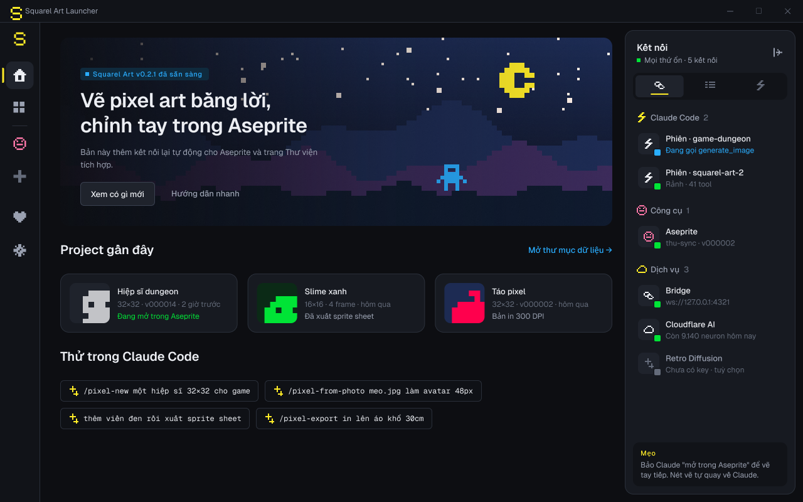

<div align="center">


# Squarel Art

**Pixel art you can talk to.** Create, edit and export real pixel art by chatting with Claude Code, then finish it by hand in Aseprite. Both sides stay in sync.

[](https://github.com/t1tc01-personal/squarel-art-2/actions/workflows/ci.yml)
[](https://github.com/t1tc01-personal/squarel-art-2/releases)
[](LICENSE.md)


**English** · [Tiếng Việt](README.vi.md) · [日本語](README.ja.md) · [简体中文](README.zh-CN.md) · [한국어](README.ko.md)



</div>

## Why Squarel

- **40+ MCP tools for Claude Code.** Draw pixels directly, or use deterministic, free operations: recolor, outline, palettes, color reduction, background removal, flip, rotate, crop, scale. Turn photos into pixel art. Generate, edit and animate with AI.
- **Real pixel art, every time.** Every AI image goes through a pixel normalizer: grid detection → the most common color per cell → palette snapping in OKLab → transparent background.
- **AI never overwrites your work.** AI results arrive as numbered proposals. Only the variant you pick is added, as a new layer. Every step is versioned and undoable.
- **Two-way live sync with Aseprite.** Claude's edits appear in Aseprite as a single undo step; your strokes flow back within half a second. Concurrent edits are merged without losing a stroke.
- **Production-ready exports.** Sprite sheets with Aseprite-style JSON, GIF, 300 DPI print PNG, SVG, PDF, avatars, emoji, WebP stickers, and Perler/Hama bead patterns with bead counts and pegboard splits.
- **Cost under control.** Chat runs on your Claude plan. AI images default to the Cloudflare Workers AI free tier, your own GPU, or an offline `mock`. Paid Retro Diffusion always quotes a price first, waits for your approval and respects a daily cap.

## Quick start

### Option A: the Windows launcher (no terminal needed)

1. Download `Squarel-Art-Launcher-Setup-X.Y.Z.exe` from [Releases](https://github.com/t1tc01-personal/squarel-art-2/releases).
2. Run it. The installer is not code-signed yet: if SmartScreen stops it, choose **More info → Run anyway**.
3. Follow the 4-step setup: install Git/Node/pnpm (via `winget`, in a visible window where you answer every prompt yourself), get Squarel, fill in `.env`, register with Claude Code.

The launcher then keeps the bridge running, shows which Aseprite and Claude Code sessions are connected, opens Aseprite, runs health checks and updates everything from GitHub Releases. See [docs/launcher.md](docs/launcher.md).

### Option B: from source

Requirements: Node.js ≥ 22.18 (tested on Node 24), pnpm, Claude Code. Optional: Aseprite 1.3+, a Cloudflare account, a Retro Diffusion key, Python + an NVIDIA GPU for [services/local-sd](services/local-sd/README.md).

```powershell
git clone https://github.com/t1tc01-personal/squarel-art-2.git
cd squarel-art-2
pnpm install
Copy-Item .env.example .env   # then edit .env
pnpm check
```

| Variable | Meaning |
|---|---|
| `DATA_DIR` | Logs, usage and any older art. Art itself lives in each project's `squarel_art/` folder: back up the project folders (for example with git) |
| `IMAGE_PROVIDER` | `cloudflare` (default), `local-sd`, or `mock` (offline, for trying things out) |
| `CLOUDFLARE_ACCOUNT_ID`, `CLOUDFLARE_API_TOKEN` | Cloudflare dashboard → AI → Workers AI → *Use REST API*. The token needs Workers AI access |
| `RETRO_DIFFUSION_API_KEY` | Optional. Used only for `quality: "high"` |
| `IMAGE_DAILY_BUDGET_USD` | Daily cap for paid images (default 1) |
| `ASEPRITE_PATH` | Path to `Aseprite.exe` |

The full step-by-step guide (Cloudflare keys, building Aseprite, troubleshooting) is in [docs/setup.md](docs/setup.md).

## Using it with Claude Code

Open Claude Code **in this repository**. `.mcp.json` already declares the `squarel` server, and Claude Code asks once whether to allow it. The skills in `.claude/skills/` teach Claude the workflow. Things you can say:

- `/pixel-new a 32×32 knight for a game, PICO-8 palette`
- "add a black outline", "make the shirt blue", "reduce to 8 colors", "undo"
- `/pixel-from-photo cat.jpg as a 48px avatar` (drop the photo into `DATA_DIR\inbox`)
- `/pixel-export print on a 30 cm t-shirt`, or "export a Hama bead pattern"

To use the server from any project:

```powershell
claude mcp add squarel --scope user -- node <repo>\src\mcp\index.ts
```

## Drawing by hand in Aseprite

```powershell
pnpm aseprite:pack   # builds squarel.aseprite-extension; double-click it to install
```

Claude Code starts the bridge at `ws://127.0.0.1:4321/bridge`. To draw without Claude Code open, run `pnpm bridge`. In Aseprite, use **File → Squarel → Open art…**, or just ask Claude to "open it in Aseprite". Don't own Aseprite? `pnpm aseprite:build` builds it from source for personal use (the Aseprite EULA forbids redistributing that build). Details: [docs/aseprite.md](docs/aseprite.md).

## Squarel vs. Aseprite MCP servers

Community MCP servers such as [diivi/aseprite-mcp](https://github.com/diivi/aseprite-mcp) and [willibrandon/pixel-mcp](https://pkg.go.dev/github.com/willibrandon/pixel-mcp) let **Claude drive Aseprite**. Squarel owns **the whole path from idea to finished file**, and Aseprite is where you draw by hand.

| | Aseprite MCP | Squarel |
|---|---|---|
| Making images | Claude places pixels by coordinate | AI drafts snapped to a real pixel grid and palette; photo → pixel art |
| Safety of your work | Claude edits the file directly | Proposals only; picked variants become new layers; full version history |
| Editing together | Easy to overwrite each other | Live two-way sync with stroke-level merging |
| Exports | What Aseprite exports | Plus print PNG, SVG, PDF, bead patterns, stickers |
| Without Aseprite | Doesn't work | Works with Claude Code or the CLI alone |

**Where Squarel is weaker:** indexed color only (≤ 256 colors), canvas ≤ 256×256, no group layers, tilemaps, tags, slices or blend modes. If you only need Claude to automate Aseprite, an Aseprite MCP is simpler. The two can be used side by side.

## Documentation

The detailed docs are currently written in Vietnamese.

| Topic | Link |
|---|---|
| Step-by-step setup | [docs/setup.md](docs/setup.md) |
| Launcher | [docs/launcher.md](docs/launcher.md) |
| Architecture | [docs/architecture.md](docs/architecture.md) |
| Tool reference | [docs/tools.md](docs/tools.md) |
| Aseprite sync | [docs/aseprite.md](docs/aseprite.md) |
| Image providers | [docs/providers.md](docs/providers.md) |
| Pixel normalizer | [docs/pixel-pipeline.md](docs/pixel-pipeline.md) |
| Export presets | [docs/export-presets.md](docs/export-presets.md) |
| Writing an integration | [docs/integrations.md](docs/integrations.md) |
| Building and releasing | [docs/release.md](docs/release.md) |

## Project layout

```
src/core        pixel algorithms (pure TypeScript, no I/O)
src/store       file-based projects, versions and proposals, with cross-process locks
src/providers   Cloudflare · Retro Diffusion · local-sd · mock, router + budget
src/tools       ~41 tools shared by MCP, CLI and bridge
src/mcp         MCP stdio server
src/bridge      WebSocket bridge + file watcher for Aseprite
src/cli         command-line interface
launcher/       Windows launcher (Electron)
integrations/   Aseprite Lua extension + integration manifests
services/       optional local Stable Diffusion service (Python)
.claude/skills  Claude Code skills
```

## Development

| Command | What it does |
|---|---|
| `pnpm check` | Typecheck + lint (Biome) + tests (Vitest) |
| `pnpm --dir launcher check` | The same for the launcher |
| `pnpm --dir launcher build` then `pnpm --dir launcher e2e` | Launcher end-to-end tests (Playwright) |
| `pnpm mcp` / `pnpm bridge` / `pnpm cli tools` | Run the MCP server, the bridge or the CLI by hand |
| `pnpm eval -- --provider mock` | Evaluate AI image quality (real providers need `--yes`) |
| `pnpm docs:tools` | Regenerate [docs/tools.md](docs/tools.md) |

## Contributing

Issues and pull requests are welcome. Please read [CONTRIBUTING.md](CONTRIBUTING.md) first. Report security issues privately as described in [SECURITY.md](SECURITY.md). Changes are listed in [CHANGELOG.md](CHANGELOG.md).

## License

Squarel Art is **source-available** under the [PolyForm Shield 1.0.0](LICENSE.md) license.

- **You may** use it for free (personally, at work, in a company), sell what you make with it (game sprites, printed shirts, stickers…), modify it, and share it with the license attached.
- **You may not** use this code to build or offer a product that **competes** with Squarel Art, paid or free (for example, rebranding and republishing it, or running an AI pixel-art service on top of it).

Third-party libraries keep their own licenses. Aseprite is covered by its own EULA. This summary is not legal advice; [LICENSE.md](LICENSE.md) is the binding text.
