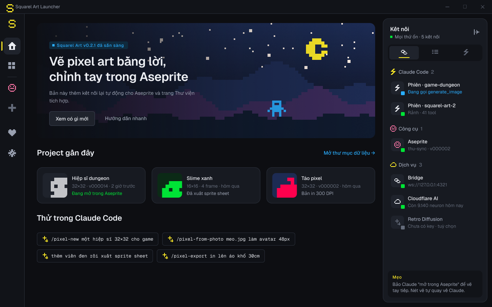

<div align="center">


# Squarel Art

**Pixel art mà bạn có thể trò chuyện.** Tạo, sửa và xuất pixel art thật bằng cách chat với Claude Code, rồi hoàn thiện bằng tay trong Aseprite. Hai bên luôn đồng bộ với nhau.

[](https://github.com/t1tc01-personal/squarel-art-2/actions/workflows/ci.yml)
[](https://github.com/t1tc01-personal/squarel-art-2/releases)
[](LICENSE.md)


[English](README.md) · **Tiếng Việt** · [日本語](README.ja.md) · [简体中文](README.zh-CN.md) · [한국어](README.ko.md)



</div>

## Vì sao chọn Squarel

- **Hơn 40 tool MCP cho Claude Code.** Vẽ pixel trực tiếp, hoặc dùng các thao tác có quy tắc và miễn phí: đổi màu, viền, palette, giảm màu, xoá nền, lật, xoay, cắt, scale. Biến ảnh chụp thành pixel art. Tạo, sửa và làm animation bằng AI.
- **Luôn ra pixel art thật.** Mọi ảnh AI đều qua bộ chuẩn hoá pixel: dò lưới → mỗi ô lấy màu xuất hiện nhiều nhất → ép palette trong OKLab → nền trong suốt.
- **AI không bao giờ ghi đè tác phẩm của bạn.** Kết quả AI đến dưới dạng các đề xuất đánh số. Chỉ biến thể bạn chọn mới được thêm vào, dưới dạng layer mới. Mọi bước đều có version và undo được.
- **Đồng bộ trực tiếp hai chiều với Aseprite.** Thay đổi của Claude hiện trong Aseprite thành một bước undo. Nét vẽ của bạn được gửi về trong vòng nửa giây. Sửa cùng lúc vẫn được gộp lại, không mất nét nào.
- **Xuất file dùng ngay.** Sprite sheet kèm JSON kiểu Aseprite, GIF, PNG in 300 DPI, SVG, PDF, avatar, emoji, sticker WebP, và mẫu hạt Perler/Hama có đếm số hạt và chia theo bảng ghim.
- **Chi phí trong tầm kiểm soát.** Chat nằm trong gói Claude của bạn. Ảnh AI mặc định dùng Cloudflare Workers AI free tier, GPU của máy bạn, hoặc `mock` chạy offline. Retro Diffusion (trả phí) luôn báo giá trước, chờ bạn đồng ý và tuân theo trần chi phí mỗi ngày.

## Bắt đầu nhanh

### Cách A: launcher cho Windows (không cần terminal)

1. Tải `Squarel-Art-Launcher-Setup-X.Y.Z.exe` từ trang [Releases](https://github.com/t1tc01-personal/squarel-art-2/releases).
2. Chạy file này. Bộ cài chưa được ký số: nếu SmartScreen chặn, chọn **More info → Run anyway**.
3. Làm theo wizard 4 bước: cài Git/Node/pnpm (qua `winget`, trong một cửa sổ hiện rõ để bạn tự trả lời mọi câu hỏi), lấy Squarel, điền `.env`, đăng ký với Claude Code.

Sau đó launcher giữ bridge luôn chạy, cho biết phiên Aseprite và Claude Code nào đang kết nối, mở Aseprite, chạy health check và cập nhật mọi thứ từ GitHub Releases. Xem [docs/launcher.md](docs/launcher.md).

### Cách B: từ source

Yêu cầu: Node.js ≥ 22.18 (đã thử với Node 24), pnpm, Claude Code. Tuỳ chọn: Aseprite 1.3+, tài khoản Cloudflare, key Retro Diffusion, Python + GPU NVIDIA cho [services/local-sd](services/local-sd/README.md).

```powershell
git clone https://github.com/t1tc01-personal/squarel-art-2.git
cd squarel-art-2
pnpm install
Copy-Item .env.example .env   # rồi sửa .env
pnpm check
```

| Biến | Ý nghĩa |
|---|---|
| `DATA_DIR` | Log, usage và art cũ. Art nằm trong thư mục `squarel_art/` của từng dự án: hãy backup thư mục dự án (ví dụ bằng git) |
| `IMAGE_PROVIDER` | `cloudflare` (mặc định), `local-sd` hoặc `mock` (offline, dùng để thử) |
| `CLOUDFLARE_ACCOUNT_ID`, `CLOUDFLARE_API_TOKEN` | Dashboard Cloudflare → AI → Workers AI → *Use REST API*. Token cần quyền Workers AI |
| `RETRO_DIFFUSION_API_KEY` | Tuỳ chọn. Chỉ dùng cho `quality: "high"` |
| `IMAGE_DAILY_BUDGET_USD` | Trần chi phí mỗi ngày cho ảnh trả phí (mặc định 1) |
| `ASEPRITE_PATH` | Đường dẫn tới `Aseprite.exe` |

Hướng dẫn đầy đủ từng bước (key Cloudflare, build Aseprite, xử lý sự cố) nằm ở [docs/setup.md](docs/setup.md).

## Dùng với Claude Code

Mở Claude Code **trong thư mục repo này**. File `.mcp.json` đã khai báo sẵn server `squarel`, và Claude Code sẽ hỏi một lần xem bạn có cho phép không. Các skill trong `.claude/skills/` dạy Claude quy trình làm việc. Những câu bạn có thể nói:

- `/pixel-new một hiệp sĩ 32×32 cho game, palette PICO-8`
- "thêm viền đen", "đổi áo sang màu xanh", "giảm còn 8 màu", "undo"
- `/pixel-from-photo meo.jpg làm avatar 48px` (thả ảnh vào `DATA_DIR\inbox`)
- `/pixel-export in lên áo thun khổ 30 cm`, hoặc "xuất mẫu hạt Hama"

Muốn dùng server này ở dự án khác:

```powershell
claude mcp add squarel --scope user -- node <repo>\src\mcp\index.ts
```

## Vẽ tay trong Aseprite

```powershell
pnpm aseprite:pack   # tạo squarel.aseprite-extension; nhấp đúp file này để cài
```

Claude Code sẽ khởi động bridge ở `ws://127.0.0.1:4321/bridge`. Muốn vẽ mà không mở Claude Code, hãy chạy `pnpm bridge`. Trong Aseprite, dùng **File → Squarel → Open art…**, hoặc chỉ cần bảo Claude "mở trong Aseprite". Chưa có Aseprite? `pnpm aseprite:build` sẽ build nó từ source để dùng cá nhân (EULA của Aseprite cấm phân phối lại bản build đó). Chi tiết: [docs/aseprite.md](docs/aseprite.md).

## Squarel và các MCP server Aseprite

Các MCP server cộng đồng như [diivi/aseprite-mcp](https://github.com/diivi/aseprite-mcp) và [willibrandon/pixel-mcp](https://pkg.go.dev/github.com/willibrandon/pixel-mcp) cho phép **Claude điều khiển Aseprite**. Squarel lo **toàn bộ quy trình từ ý tưởng đến file hoàn chỉnh**, còn Aseprite là nơi bạn vẽ tay.

| | MCP Aseprite | Squarel |
|---|---|---|
| Tạo hình | Claude đặt từng pixel theo toạ độ | AI tạo bản nháp rồi ép về lưới pixel thật và đúng palette; ảnh chụp → pixel art |
| An toàn cho tác phẩm | Claude sửa thẳng vào file | Chỉ có đề xuất; biến thể được chọn mới thành layer mới; có đầy đủ lịch sử version |
| Cùng chỉnh sửa | Dễ ghi đè lẫn nhau | Đồng bộ trực tiếp hai chiều, gộp ở mức từng nét vẽ |
| Xuất file | Những gì Aseprite xuất được | Thêm PNG in, SVG, PDF, mẫu hạt, sticker |
| Khi không có Aseprite | Không chạy được | Vẫn chạy với Claude Code hoặc CLI |

**Squarel kém hơn ở đâu:** chỉ có màu indexed (≤ 256 màu), canvas ≤ 256×256, không có layer nhóm, tilemap, tag, slice hay blend mode. Nếu bạn chỉ cần Claude tự động hoá Aseprite, MCP Aseprite đơn giản hơn. Có thể dùng cả hai cùng lúc.

## Tài liệu

Tài liệu chi tiết hiện được viết bằng tiếng Việt.

| Chủ đề | Liên kết |
|---|---|
| Cài đặt từng bước | [docs/setup.md](docs/setup.md) |
| Launcher | [docs/launcher.md](docs/launcher.md) |
| Kiến trúc | [docs/architecture.md](docs/architecture.md) |
| Danh mục tool | [docs/tools.md](docs/tools.md) |
| Đồng bộ Aseprite | [docs/aseprite.md](docs/aseprite.md) |
| Provider ảnh | [docs/providers.md](docs/providers.md) |
| Chuẩn hoá pixel | [docs/pixel-pipeline.md](docs/pixel-pipeline.md) |
| Preset xuất file | [docs/export-presets.md](docs/export-presets.md) |
| Viết tích hợp | [docs/integrations.md](docs/integrations.md) |
| Build và phát hành | [docs/release.md](docs/release.md) |

## Cấu trúc project

```
src/core        thuật toán pixel (TypeScript thuần, không I/O)
src/store       project, version và proposal lưu trên file, khoá giữa các tiến trình
src/providers   Cloudflare · Retro Diffusion · local-sd · mock, router + ngân sách
src/tools       ~41 tool dùng chung cho MCP, CLI và bridge
src/mcp         MCP server stdio
src/bridge      WebSocket bridge + theo dõi file cho Aseprite
src/cli         giao diện dòng lệnh
launcher/       launcher cho Windows (Electron)
integrations/   extension Lua cho Aseprite + manifest tích hợp
services/       service Stable Diffusion chạy local (Python, tuỳ chọn)
.claude/skills  skill cho Claude Code
```

## Phát triển

| Lệnh | Việc |
|---|---|
| `pnpm check` | Typecheck + lint (Biome) + test (Vitest) |
| `pnpm --dir launcher check` | Tương tự, cho launcher |
| `pnpm --dir launcher build` rồi `pnpm --dir launcher e2e` | Test end-to-end cho launcher (Playwright) |
| `pnpm mcp` / `pnpm bridge` / `pnpm cli tools` | Chạy bằng tay MCP server, bridge hoặc CLI |
| `pnpm eval -- --provider mock` | Đánh giá chất lượng ảnh AI (provider thật cần `--yes`) |
| `pnpm docs:tools` | Sinh lại [docs/tools.md](docs/tools.md) |

## Đóng góp

Rất hoan nghênh issue và pull request. Vui lòng đọc [CONTRIBUTING.md](CONTRIBUTING.md) trước. Hãy báo lỗi bảo mật một cách riêng tư theo hướng dẫn trong [SECURITY.md](SECURITY.md). Các thay đổi được liệt kê trong [CHANGELOG.md](CHANGELOG.md).

## Giấy phép

Squarel Art là phần mềm **source-available** theo giấy phép [PolyForm Shield 1.0.0](LICENSE.md).

- **Bạn được phép** dùng miễn phí (cá nhân, công việc, công ty), bán những gì bạn làm ra bằng nó (sprite game, áo in, sticker…), sửa đổi nó, và chia sẻ lại kèm giấy phép.
- **Bạn không được phép** dùng code này để làm hoặc cung cấp một sản phẩm **cạnh tranh** với Squarel Art, dù bán hay miễn phí (ví dụ: đổi tên rồi phát hành lại, hoặc dựng một dịch vụ tạo pixel art bằng AI dựa trên nó).

Thư viện bên thứ ba giữ giấy phép riêng của chúng. Aseprite theo EULA riêng. Phần tóm tắt này không phải tư vấn pháp lý; [LICENSE.md](LICENSE.md) mới là văn bản có hiệu lực.
