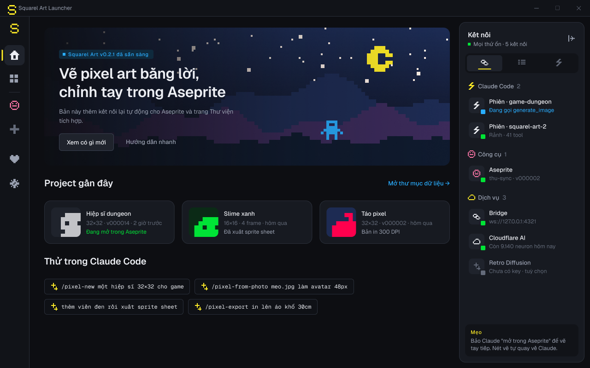

<div align="center">

# Squarel Art

**能对话的像素画。** 通过与 Claude Code 聊天来创建、编辑和导出真正的像素画，再在 Aseprite 中亲手收尾。两边始终保持同步。

[](https://github.com/t1tc01-personal/squarel-art-2/actions/workflows/ci.yml)
[](https://github.com/t1tc01-personal/squarel-art-2/releases)
[](LICENSE.md)


[English](README.md) · [Tiếng Việt](README.vi.md) · [日本語](README.ja.md) · **简体中文** · [한국어](README.ko.md)



</div>

## 为什么选择 Squarel

- **为 Claude Code 提供 40+ 个 MCP 工具。** 可以直接绘制像素，也可以使用确定性的免费操作：重新着色、描边、调色板、颜色缩减、背景移除、翻转、旋转、裁剪、缩放。支持照片转像素画，也支持用 AI 生成、编辑和制作动画。
- **每次都是真正的像素画。** 所有 AI 图像都会经过像素规范化处理：网格检测 → 取每个格子中出现最多的颜色 → 在 OKLab 空间中吸附到调色板 → 透明背景。
- **AI 绝不会覆盖你的作品。** AI 的结果以编号方案的形式呈现，只有你选中的变体才会作为新图层加入。每一步都有版本记录，可随时撤销。
- **与 Aseprite 双向实时同步。** Claude 的修改会在 Aseprite 中作为一步撤销出现；你的笔触会在半秒内同步回来。并发编辑会自动合并，不会丢失任何一笔。
- **可直接用于生产的导出。** 带 Aseprite 风格 JSON 的精灵表、GIF、300 DPI 打印 PNG、SVG、PDF、头像、表情、WebP 贴纸，以及带拼豆数量和底板拆分的 Perler/Hama 拼豆图纸。
- **成本可控。** 聊天使用你的 Claude 套餐。AI 图像默认使用 Cloudflare Workers AI 免费额度、你自己的 GPU，或离线的 `mock`。付费的 Retro Diffusion 总是先报价，等你批准后才执行，并遵守每日上限。

## 快速开始

### 方案 A：Windows 启动器（无需终端）

1. 从 [Releases](https://github.com/t1tc01-personal/squarel-art-2/releases) 下载 `Squarel-Art-Launcher-Setup-X.Y.Z.exe`。
2. 运行安装程序。安装包尚未进行代码签名：如果 SmartScreen 拦截，请选择 **更多信息 → 仍要运行**。
3. 按照 4 步设置操作：安装 Git/Node/pnpm（通过 `winget`，在可见窗口中进行，每个提示都由你亲自确认）、获取 Squarel、填写 `.env`、注册到 Claude Code。

之后启动器会保持桥接服务运行，显示哪些 Aseprite 和 Claude Code 会话已连接，还能打开 Aseprite、运行健康检查，并通过 GitHub Releases 更新所有组件。详见 [docs/launcher.md](docs/launcher.md)。

### 方案 B：从源码运行

环境要求：Node.js ≥ 22.18（已在 Node 24 上测试）、pnpm、Claude Code。可选：Aseprite 1.3+、Cloudflare 账号、Retro Diffusion 密钥，以及用于 [services/local-sd](services/local-sd/README.md) 的 Python 和 NVIDIA GPU。

```powershell
git clone https://github.com/t1tc01-personal/squarel-art-2.git
cd squarel-art-2
pnpm install
Copy-Item .env.example .env   # 然后编辑 .env
pnpm check
```

| 变量 | 含义 |
|---|---|
| `DATA_DIR` | 存放日志、用量和旧作品。作品本身在各项目的 `squarel_art/` 文件夹中，请备份项目文件夹（例如用 git） |
| `IMAGE_PROVIDER` | `cloudflare`（默认）、`local-sd` 或 `mock`（离线，用于试用） |
| `CLOUDFLARE_ACCOUNT_ID`, `CLOUDFLARE_API_TOKEN` | Cloudflare 控制台 → AI → Workers AI → *Use REST API*。令牌需要具有 Workers AI 权限 |
| `RETRO_DIFFUSION_API_KEY` | 可选。仅在 `quality: "high"` 时使用 |
| `IMAGE_DAILY_BUDGET_USD` | 付费图像的每日上限（默认 1） |
| `ASEPRITE_PATH` | `Aseprite.exe` 的路径 |

完整的分步指南（Cloudflare 密钥、构建 Aseprite、故障排查）见 [docs/setup.md](docs/setup.md)。

## 在 Claude Code 中使用

**在本仓库中**打开 Claude Code。`.mcp.json` 已声明 `squarel` 服务器，Claude Code 会询问一次是否允许使用。`.claude/skills/` 中的技能会教 Claude 掌握工作流程。你可以这样说：

- `/pixel-new 一个 32×32 的游戏骑士，使用 PICO-8 调色板`
- “加一圈黑色描边”、“把衬衫改成蓝色”、“减少到 8 种颜色”、“撤销”
- `/pixel-from-photo 把 cat.jpg 做成 48px 的头像`（把照片放进 `DATA_DIR\inbox`）
- `/pixel-export 打印在 30 厘米的 T 恤上`，或者“导出 Hama 拼豆图纸”

若要在任意项目中使用该服务器：

```powershell
claude mcp add squarel --scope user -- node <repo>\src\mcp\index.ts
```

## 在 Aseprite 中手绘

```powershell
pnpm aseprite:pack   # 构建 squarel.aseprite-extension；双击即可安装
```

Claude Code 会在 `ws://127.0.0.1:4321/bridge` 启动桥接服务。若想在不打开 Claude Code 的情况下绘制，请运行 `pnpm bridge`。在 Aseprite 中使用 **File → Squarel → Open art…**，或者直接让 Claude “在 Aseprite 中打开”。没有 Aseprite？`pnpm aseprite:build` 可以从源码构建，仅供个人使用（Aseprite 的 EULA 禁止再分发该构建版本）。详情：[docs/aseprite.md](docs/aseprite.md)。

## Squarel 与 Aseprite MCP 服务器的对比

社区中的 MCP 服务器，例如 [diivi/aseprite-mcp](https://github.com/diivi/aseprite-mcp) 和 [willibrandon/pixel-mcp](https://pkg.go.dev/github.com/willibrandon/pixel-mcp)，让 **Claude 去操控 Aseprite**。Squarel 负责**从创意到成品文件的完整流程**，而 Aseprite 是你手绘的地方。

| | Aseprite MCP | Squarel |
|---|---|---|
| 生成图像 | Claude 按坐标逐个放置像素 | AI 草稿会吸附到真实的像素网格和调色板；照片 → 像素画 |
| 作品的安全性 | Claude 直接编辑文件 | 仅提供方案；选中的变体成为新图层；完整的版本历史 |
| 协同编辑 | 容易互相覆盖 | 双向实时同步，支持笔触级合并 |
| 导出 | Aseprite 能导出什么就是什么 | 另有打印 PNG、SVG、PDF、拼豆图纸、贴纸 |
| 没有 Aseprite 时 | 无法使用 | 仅用 Claude Code 或 CLI 即可使用 |

**Squarel 的不足之处：** 仅支持索引色（≤ 256 色），画布 ≤ 256×256，不支持图层组、瓦片地图、标签、切片或混合模式。如果你只需要让 Claude 自动化操作 Aseprite，Aseprite MCP 会更简单。两者也可以搭配使用。

## 文档

详细文档目前仅有越南语版本。

| 主题 | 链接 |
|---|---|
| 分步安装指南 | [docs/setup.md](docs/setup.md) |
| 启动器 | [docs/launcher.md](docs/launcher.md) |
| 架构 | [docs/architecture.md](docs/architecture.md) |
| 工具参考 | [docs/tools.md](docs/tools.md) |
| Aseprite 同步 | [docs/aseprite.md](docs/aseprite.md) |
| 图像提供方 | [docs/providers.md](docs/providers.md) |
| 像素规范化 | [docs/pixel-pipeline.md](docs/pixel-pipeline.md) |
| 导出预设 | [docs/export-presets.md](docs/export-presets.md) |
| 编写集成 | [docs/integrations.md](docs/integrations.md) |
| 构建与发布 | [docs/release.md](docs/release.md) |

## 项目结构

```
src/core        pixel algorithms (pure TypeScript, no I/O)
src/store       file-based projects, versions and proposals, with cross-process locks
src/providers   Cloudflare · Retro Diffusion · local-sd · mock, router + budget
src/tools       ~41 tools shared by MCP, CLI and bridge
src/mcp         MCP stdio server
src/bridge      WebSocket bridge + file watcher for Aseprite
src/cli         command-line interface
launcher/       Windows launcher (Electron)
integrations/   Aseprite Lua extension + integration manifests
services/       optional local Stable Diffusion service (Python)
.claude/skills  Claude Code skills
```

## 开发

| 命令 | 作用 |
|---|---|
| `pnpm check` | 类型检查 + 代码检查（Biome）+ 测试（Vitest） |
| `pnpm --dir launcher check` | 对启动器执行同样的检查 |
| `pnpm --dir launcher build` 然后 `pnpm --dir launcher e2e` | 启动器端到端测试（Playwright） |
| `pnpm mcp` / `pnpm bridge` / `pnpm cli tools` | 手动运行 MCP 服务器、桥接服务或 CLI |
| `pnpm eval -- --provider mock` | 评估 AI 图像质量（使用真实提供方需加 `--yes`） |
| `pnpm docs:tools` | 重新生成 [docs/tools.md](docs/tools.md) |

## 参与贡献

欢迎提交 Issue 和 Pull Request。请先阅读 [CONTRIBUTING.md](CONTRIBUTING.md)。安全问题请按 [SECURITY.md](SECURITY.md) 中的说明私下报告。变更记录见 [CHANGELOG.md](CHANGELOG.md)。

## 许可证

Squarel Art 以 [PolyForm Shield 1.0.0](LICENSE.md) 许可证提供**源码可用**（source-available）授权。

- **你可以**免费使用（个人、工作或公司内均可），出售用它制作的成果（游戏精灵、印制的 T 恤、贴纸等），修改它，并在附带许可证的前提下分享它。
- **你不可以**使用这些代码构建或提供与 Squarel Art **竞争**的产品，无论收费与否（例如更换品牌后重新发布，或在其之上运营 AI 像素画服务）。

第三方库保留各自的许可证。Aseprite 受其自身 EULA 约束。本摘要不构成法律意见；具有约束力的文本以 [LICENSE.md](LICENSE.md) 为准。
