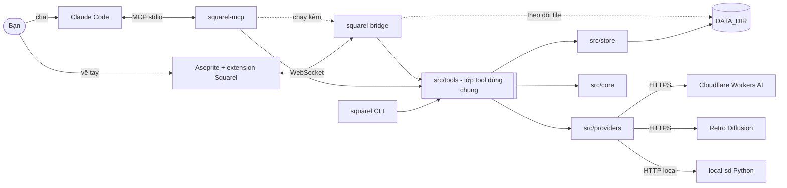
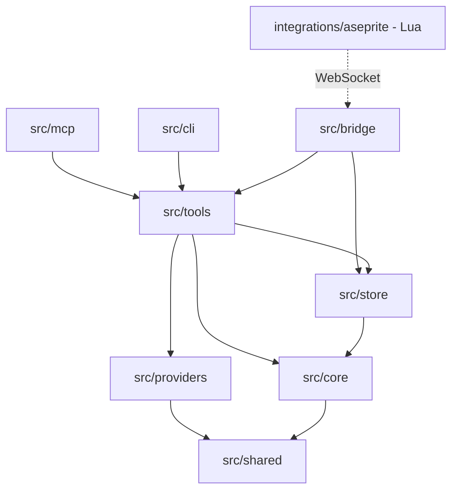
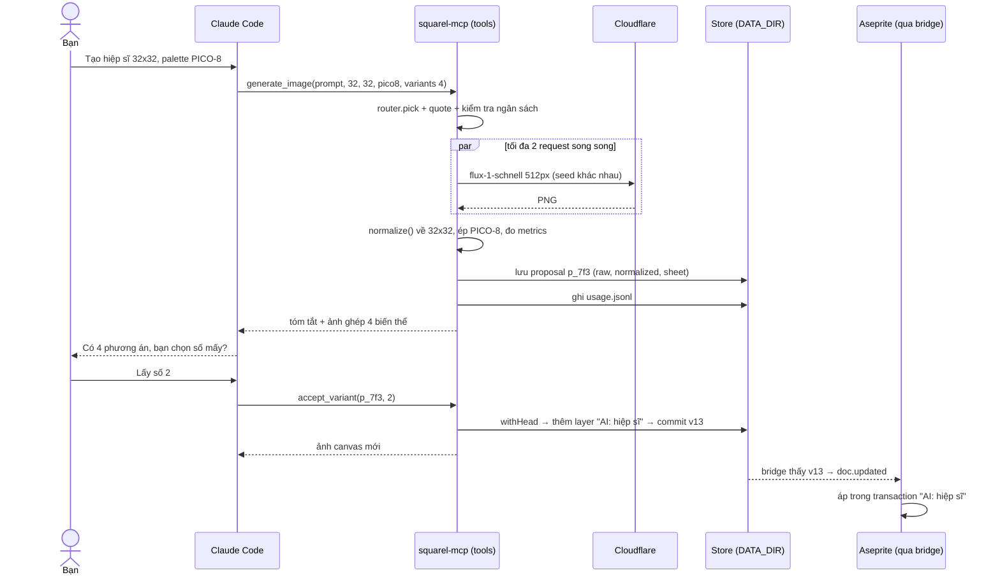
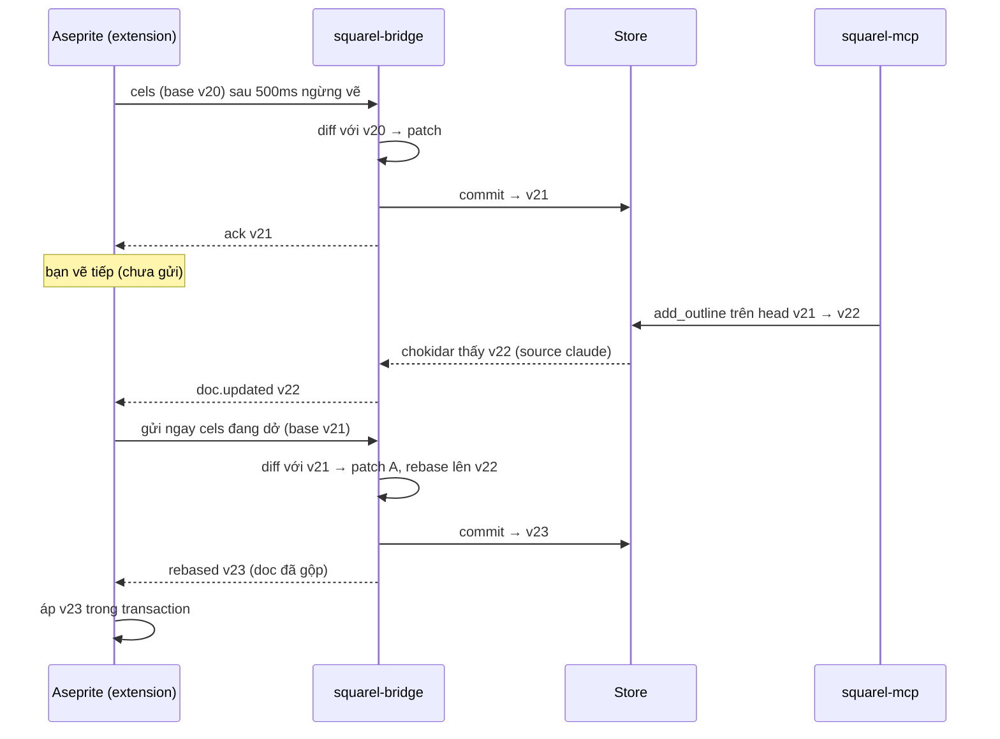

# Kiến trúc hệ thống — Squarel Art (bản cá nhân, cắm vào Claude Code)

> Đi kèm [kế hoạch cá nhân](plans/2026-11-22-personal-tool-plan.md). Ngày: 2026-11-22. Trạng thái: **thiết kế, chưa có code**.
> Tài liệu này chốt cụ thể các tiến trình, module, interface, cấu trúc dữ liệu và luồng xử lý, để lúc build không phải đoán.
> **Editor:** Aseprite + extension Lua, chọn ngày 2026-11-22 (xem [editor-options.md](editor-options.md)). Không còn editor web tự viết.
>
> **Ghi chú triển khai v0.1 (2026-11-22):** code đã có đủ các phần dưới đây (`pnpm check`: 73 test). Những điểm khác so với thiết kế ban đầu:
> - **`withHead` giữ khoá trong suốt chuỗi đọc → sửa → ghi.** Không còn cơ chế thử lại khi gặp `CONFLICT`, vì test với 2 tiến trình ghi cùng lúc cho thấy cơ chế đó không đủ.
> - **Bridge luôn tính patch rồi rebase lên head,** kể cả khi head chưa đổi, để giữ `meta` (title, maxColors) của bản trên máy.
> - **Prompt cho model đa năng yêu cầu nền magenta** chứ không phải nền trắng. Màu này dùng làm phông để xoá nền.
> - **Despeckle chỉ xoá chấm lạc giữa vùng trong suốt,** giữ lại pixel đơn lẻ bên trong sprite (mắt, điểm sáng).
> - **Tổng cộng 41 tool.** Có thêm `frame_*`, `palette_set_color`, `proposal_list`, `layer_merge_down`.
> - **Extension Lua tự mang theo `json.lua`,** vì không phải bản Aseprite nào cũng có sẵn `json`. Extension dùng `image.bytes` khi có, nếu không thì quay về `getPixel`/`drawPixel`.
> - **Extension được test trên fengari** (máy ảo Lua chạy trong Node) với API Aseprite giả lập. Chưa test trên Aseprite thật: dùng `pnpm aseprite:test`.

---

## 1. Toàn cảnh

### 1.1 Các tiến trình khi chạy

| Tiến trình | Ai khởi động | Vai trò | Giao tiếp |
|---|---|---|---|
| **Claude Code** | Bạn mở | Chatbot: hiểu yêu cầu, gọi tool, xem ảnh preview | MCP qua stdio tới `squarel-mcp` |
| **squarel-mcp** | Claude Code tự chạy khi mở session (khai báo trong `.mcp.json`) | Cung cấp ~30 tool pixel art | stdin/stdout (JSON-RPC). Log chỉ ghi ra **stderr** và file |
| **squarel-bridge** | Chạy kèm trong `squarel-mcp` nếu cổng 4321 còn trống; hoặc `pnpm bridge` khi muốn vẽ mà không mở Claude Code | Đồng bộ với Aseprite, theo dõi file, gọi Aseprite CLI | WebSocket `ws://127.0.0.1:4321/bridge` |
| **Aseprite** + extension `Squarel` | Bạn mở | Vẽ tay. Extension Lua đồng bộ hai chiều | WebSocket tới bridge. Aseprite CLI (`-b --script`) cho chế độ trao đổi qua file |
| **local-sd** (tuỳ chọn) | `pnpm local-sd` (uvicorn) | Sinh ảnh SD1.5 trên GTX 1650 | HTTP `127.0.0.1:7861` |
| Dịch vụ ngoài | — | Cloudflare Workers AI · Retro Diffusion | HTTPS |

Hệ thống **không có database và không có daemon chạy nền**. Trạng thái chung duy nhất là thư mục `DATA_DIR` trên đĩa. Mọi tiến trình Node (`squarel-mcp`, `pnpm bridge`, CLI) đều đọc/ghi thư mục này qua cùng một thư viện `src/store`. Aseprite không ghi thẳng vào `DATA_DIR`: mọi thay đổi đều đi qua bridge.



### 1.2 Nguyên tắc thiết kế
1. **Tool chỉ viết một lần** trong `src/tools`. MCP, CLI và bridge (cho Aseprite) đều chỉ là lớp vỏ mỏng gọi vào đó.
2. **`src/core` thuần tính toán:** không đọc file, không gọi mạng. Nhờ vậy chạy được cả trong trình duyệt lẫn Node, và test dễ.
3. **Lịch sử chỉ thêm, không sửa:** mỗi thay đổi tạo một version mới, kể cả undo. Không bao giờ ghi đè.
4. **AI không ghi đè tác phẩm:** kết quả AI là đề xuất (proposal). Khi chấp nhận thì đặt vào một layer mới.
5. **Chi phí được chặn bằng code**, không chỉ dựa vào lời dặn trong prompt: có `confirm_cost` và trần chi phí hằng ngày.

---

## 2. Phân lớp module & quy tắc phụ thuộc



| Module | Chạy ở | Trách nhiệm | Được import |
|---|---|---|---|
| `shared` | browser + Node | zod schema, type, hằng số, palette preset, bảng màu hạt | không import module nào |
| `core` | browser + Node | Toàn bộ thuật toán pixel. Chỉ dùng `Uint8Array`, không dùng `Buffer`/`fs` | `shared` |
| `store` | Node | Đọc/ghi `DATA_DIR`, version, proposal, khoá file, nhật ký chi phí | `core`, `shared` |
| `providers` | Node | Gọi API ảnh, router, retry, ngân sách | `shared` |
| `tools` | Node | Logic nghiệp vụ của từng tool | `core`, `store`, `providers`, `shared` |
| `mcp` / `cli` / `bridge` | Node | Lớp vỏ: chuyển đổi giao thức | `tools` (bridge dùng thêm `store` để đọc head và tính diff) |
| `integrations/aseprite` | Lua trong Aseprite | Extension đồng bộ + script batch `doc.json ↔ .aseprite` | Không import code TS. Chỉ nói chuyện qua giao thức bridge (mục 9) |

Quy tắc này được **kiểm tra tự động bằng `dependency-cruiser`** trong `pnpm lint`. Ví dụ: nếu `core` import `fs` thì lint báo lỗi.

---

## 3. Mô hình dữ liệu

### 3.1 `PixelDoc` — định dạng chuẩn của một tác phẩm

```ts
type Purpose = 'game' | 'print' | 'digital' | 'craft'

interface PixelDoc {
  v: 1
  width: number                 // 1..256
  height: number                // 1..256
  palette: string[]             // "#rrggbbaa"; palette[0] luôn = "#00000000" (trong suốt); ≤ 256 màu
  layers: Layer[]               // dưới → trên
  frames: Frame[]               // ≥ 1
  cels: Record<string, string>  // key "layerId:frameId" → base64(RLE(chỉ số palette))
  meta: { purpose: Purpose; title?: string; tags?: AnimTag[] }
}
interface Layer { id: string; name: string; visible: boolean; opacity: number; locked: boolean; origin?: 'user' | 'ai' | 'claude' }
interface Frame { id: string; durationMs: number }
interface AnimTag { name: string; from: number; to: number }   // ví dụ "walk" từ frame 0 đến 3
```

- **Trong bộ nhớ:** mỗi cel được giải nén thành `Uint8Array(width*height)`. Giá trị mỗi phần tử là chỉ số trong palette.
- **RLE:** chuỗi cặp `[độ dài dải (varint), chỉ số màu (u8)]`, sau đó mã hoá base64. Ảnh pixel art có nhiều vùng cùng màu nên RLE nén rất tốt.
- **Bất biến**, được kiểm bằng `core.validateDoc()` trước mỗi lần ghi:
  - `palette[0]` là màu trong suốt.
  - Mọi chỉ số < `palette.length`.
  - Mỗi cặp layer × frame có đúng một cel.
  - Các id là duy nhất.
  - Kích thước và số màu nằm trong giới hạn.

### 3.2 Trên đĩa (`DATA_DIR`, mặc định `D:\SquarelArt-data`)

```
DATA_DIR/
  config.json                         tuỳ chọn: ghi đè cấu hình mặc định
  inbox/                              thả ảnh chụp / ảnh tham chiếu vào đây
  logs/mcp.log  logs/bridge.log
  usage.jsonl                         mỗi lần gọi provider ảnh 1 dòng
  projects/<slug>/
    project.json                      { slug, name, purpose, createdAt, head: "v000042" }
    versions/index.jsonl              mỗi version 1 dòng: { id, parent, ts, source, label, bytes }
    versions/v000042.json.gz          { id, parent, ts, source, label, doc: PixelDoc }
    proposals/<pid>/meta.json         xem mục 3.3
    proposals/<pid>/raw-1.png …       ảnh gốc provider trả về
    proposals/<pid>/v1.json …         biến thể đã chuẩn hoá (pixels + palette + metrics)
    proposals/<pid>/sheet.png         ảnh ghép các biến thể, có đánh số
    assets/                           ảnh tham chiếu đã sao chép vào project
    exports/<preset>-<ts>.<ext>       file đã xuất
    work.aseprite                     file làm việc cho chế độ trao đổi qua file (sinh tự động)
    .lock                             khoá ghi (proper-lockfile)
```

- **`slug`:** khớp `^[a-z0-9][a-z0-9-]{0,63}$`. Mọi đường dẫn được resolve và kiểm tra vẫn nằm trong `DATA_DIR`, để chặn path traversal.
- **`source`** của version là một trong: `claude` | `editor` | `ai` | `cli` | `import`. Extension Aseprite dùng giá trị này để đặt tên transaction (ví dụ "Claude: …") và hiện thông báo.
- **`usage.jsonl`**, mỗi dòng: `{ ts, provider, model, op, units, unitKind: 'neuron'|'credit'|'none', usd, project, proposal, ok }`.

### 3.3 Proposal (đề xuất do AI tạo)

```ts
interface ProposalMeta {
  id: string                         // "p_7f3a"
  createdAt: string
  kind: 'generate' | 'edit' | 'animate'
  baseVersion: string                // version lúc yêu cầu
  request: { prompt: string; width: number; height: number; palette?: string; quality: 'free' | 'high'; region?: Rect }
  provider: string; model: string; costUsd: number
  variants: { n: number; raw: string; normalized: string; metrics: NormalizeReport }[]
  status: 'open' | 'accepted' | 'discarded'
  acceptedVariant?: number; acceptedInVersion?: string
}
```

### 3.4 Ghi an toàn khi có nhiều tiến trình
`squarel-mcp`, `pnpm bridge` và CLI có thể là **nhiều tiến trình khác nhau cùng ghi vào một project**. Mỗi lần commit đi theo trình tự:

1. Lấy khoá `.lock`. Khoá tự hết hạn sau 10 giây nếu tiến trình giữ khoá bị crash.
2. Đọc `project.json.head` rồi so với `baseVersion` người gọi đưa vào.
   - Nếu khác: trả lỗi `CONFLICT` kèm head hiện tại. Người gọi tự đọc lại và thử lại.
3. Ghi file version vào file tạm, rồi `rename` sang tên thật. Rename là thao tác nguyên tử.
4. Ghi thêm 1 dòng vào `index.jsonl`.
5. Cập nhật `project.json` theo cách tạm + rename.
6. Nhả khoá.

Tool phía Claude không giữ bản doc cũ: **luôn đọc head ngay trước khi sửa**, nên gần như không gặp `CONFLICT`. Nếu vẫn gặp thì tự thử lại tối đa 3 lần.

---

## 4. Các interface chính

### 4.1 Tool dùng chung (`src/tools/types.ts`)

```ts
interface ToolDef<I extends z.ZodTypeAny = z.ZodTypeAny> {
  name: string                                   // snake_case, ví dụ "add_outline"
  title: string
  description: string                            // viết cho Claude đọc: khi nào dùng, tốn tiền không
  input: I                                       // zod schema
  annotations: { readOnly?: boolean; costly?: boolean; mutates?: boolean }
  handler(ctx: ToolContext, input: z.infer<I>): Promise<ToolResult>
}

interface ToolContext {
  store: Store
  providers: ProviderRouter
  session: { activeProject?: string }            // mỗi tiến trình MCP giữ một bản riêng
  config: Config
  log: Logger                                    // không bao giờ ghi ra stdout
  signal: AbortSignal
  progress?(done: number, total: number, message?: string): void
}

interface ToolResult {
  text: string                                   // tóm tắt ngắn cho Claude
  images?: { png: Uint8Array; alt: string }[]    // tối đa 2 ảnh, cạnh dài ≤ 512px
  files?: string[]                               // đường dẫn tuyệt đối của file vừa tạo
  data?: unknown                                 // JSON có cấu trúc (CLI và bridge dùng)
}

class ToolError extends Error {
  constructor(public code: 'NOT_FOUND' | 'INVALID' | 'CONFLICT' | 'BUDGET' | 'NEEDS_CONFIRM' | 'PROVIDER' | 'TIMEOUT', msg: string, public data?: unknown) { super(msg) }
}
```

- Mọi tool đều nhận tham số tuỳ chọn `project?: string`. Nếu bỏ trống thì dùng `session.activeProject`.
- Tool có sửa ảnh luôn nhận thêm `preview?: number`, mặc định 256px, đặt 0 để tắt preview.

### 4.2 Store (`src/store`)

```ts
interface Store {
  listProjects(): Promise<ProjectSummary[]>
  createProject(p: { name: string; width: number; height: number; purpose: Purpose; palette?: string[] }): Promise<ProjectSummary>
  readHead(slug: string): Promise<{ versionId: string; doc: PixelDoc }>
  commit(slug: string, c: { baseVersion: string; doc: PixelDoc; source: Source; label: string }): Promise<string>  // trả về versionId mới
  history(slug: string, limit?: number): Promise<VersionInfo[]>
  readVersion(slug: string, id: string): Promise<PixelDoc>
  proposals: ProposalStore
  exports: { write(slug: string, name: string, bytes: Uint8Array): Promise<string> }
  usage: { append(e: UsageEntry): Promise<void>; summary(range: 'today' | 'month'): Promise<UsageSummary> }
}
```

Có thêm hàm tiện ích `withHead(slug, source, label, fn: (doc) => PixelDoc)`. Hàm này gói cả chuỗi đọc head → áp `fn` → commit → tự thử lại khi `CONFLICT`. **Mọi tool sửa ảnh đều dùng hàm này.**

### 4.3 Provider ảnh (`src/providers`)

```ts
interface ImageProvider {
  id: 'cloudflare' | 'retrodiffusion' | 'local-sd' | 'mock'
  capabilities: { generate: boolean; img2img: boolean; inpaint: boolean; animate: boolean; nativePixel: boolean; paletteInput: boolean; maxSide: number }
  quote(req: GenRequest | EditRequest): Promise<{ usd: number; units: number; unitKind: UnitKind }>
  generate(req: GenRequest, signal: AbortSignal): Promise<RawImage[]>
  edit?(req: EditRequest, signal: AbortSignal): Promise<RawImage[]>
  animate?(req: AnimRequest, signal: AbortSignal): Promise<RawImage[]>   // trả về sprite sheet
  health(): Promise<boolean>
}
interface RawImage { png: Uint8Array; width: number; height: number; seed?: number }

interface ProviderRouter {
  pick(task: 'generate' | 'edit' | 'animate', quality: 'free' | 'high'): ImageProvider   // theo cấu hình + capability + health
  budget: { check(quote): void /* ném ToolError BUDGET */; record(entry): Promise<void> }
}
```

| Adapter | Endpoint (kiểm tra lại docs lúc build) | Ghi chú |
|---|---|---|
| `cloudflare` | `POST https://api.cloudflare.com/client/v4/accounts/{ACCOUNT_ID}/ai/run/@cf/black-forest-labs/flux-1-schnell` | Trả về ảnh base64. Mặc định 4 step, 512px. Đếm neuron để không vượt free tier |
| `retrodiffusion` | API của Retro Diffusion (header token) | `check_cost` để báo giá trước. Hỗ trợ `input_palette`, animation, tileset |
| `local-sd` | `POST http://127.0.0.1:7861/generate`, `/img2img` | Service FastAPI do mình viết. `health()` cho biết service có đang chạy |
| `mock` | Không gọi mạng | Trả ảnh fixture theo seed, giá $0 |

**Quy tắc chung cho mọi adapter:**
- Timeout 90 giây mỗi request.
- Gặp lỗi 429 hoặc 5xx: thử lại 2 lần, giãn cách 1 → 3 giây.
- Tối đa 2 request đồng thời cho mỗi provider (dùng `p-limit`).
- Chuỗi fallback khi `quality:'free'`: `cloudflare` → `local-sd` (nếu `health()` ok) → báo lỗi.
- **Không bao giờ tự nhảy sang provider tốn tiền.**

### 4.4 Chuẩn hoá pixel (`src/core/normalize`)

```ts
function normalize(img: RGBA, opts: {
  target?: { width: number; height: number }   // kích thước đích của doc
  palette?: string[]                            // ép theo palette cho trước
  maxColors?: number                            // mặc định 16 nếu không có palette
  removeBackground?: boolean                    // mặc định true khi ảnh không có alpha
  despeckle?: boolean                           // mặc định true
}): { pixels: Uint8Array; palette: string[]; width: number; height: number; report: NormalizeReport }

interface NormalizeReport { blockSize: number; offset: [number, number]; gridConfidence: number; colorCount: number; transparentRatio: number; warnings: string[] }
```

Thuật toán chi tiết nằm ở mục 7.

### 4.5 Preset xuất file (`src/core/export`)

```ts
interface ExportPreset<O = unknown> {
  id: string; purpose: Purpose; label: string; options: z.ZodType<O>
  run(doc: PixelDoc, opts: O): Promise<{ name: string; bytes: Uint8Array; mime: string }[]>
}
```

| id | Đầu ra |
|---|---|
| `game-png` | PNG 1× trong suốt; `scale` 1/2/4/8 |
| `game-spritesheet` | PNG sheet + JSON theo định dạng Aseprite (array), có `frameTags` |
| `game-gif` | GIF theo `durationMs` của từng frame |
| `print-png` | PNG phóng to nearest-neighbor tới `widthMm`/`heightMm` ở 300 DPI, ghi DPI vào chunk `pHYs` |
| `print-svg` | SVG, mỗi màu là một `<path>` gộp các ô vuông |
| `print-pdf` | PDF 1 trang đúng kích thước in (pdf-lib) |
| `social-avatar` | PNG 512/1024 |
| `social-emoji` | PNG 128 |
| `social-sticker` | WebP 512 (dùng sharp) |
| `social-anim` | GIF / APNG |
| `craft-beads` | PDF mẫu hạt: lưới, ký hiệu, bảng màu theo hãng Perler/Hama, **số hạt mỗi màu**, chia theo bảng ghim 29×29. Kèm CSV |

---

## 5. Danh mục tool

Mọi tool đều có tham số tuỳ chọn `project`. Cột "Ghi" cho biết tool có tạo version mới không; "$" là tool có thể tốn tiền.

| Tool | Input chính | Ghi | $ | Trả về |
|---|---|---|---|---|
| `project_list` | — | | | danh sách project |
| `project_create` | name, width, height, purpose, palette? | ✓ | | info + ảnh canvas trống |
| `project_open` | slug | | | đặt làm project đang mở + ảnh preview |
| `project_info` | — | | | kích thước, palette, layers, frames, head |
| `canvas_view` | scale?, layer?, frame?, grid?, coords? | | | **ảnh** (có lưới và toạ độ nếu bật) |
| `palette_view` | — | | | ảnh các ô màu đánh số + danh sách hex |
| `draw_pixels` | layer?, frame?, ops[] (`set`/`line`/`rect`/`ellipse`/`fill`), color (hex hoặc chỉ số) | ✓ | | ảnh sau khi vẽ |
| `layer_add` / `layer_remove` / `layer_merge` / `layer_reorder` / `layer_set` | … | ✓ | | info |
| `recolor` | from, to, layer?, tolerance? | ✓ | | ảnh |
| `apply_palette` | preset \| colors[], dither? | ✓ | | ảnh |
| `reduce_colors` | n | ✓ | | ảnh |
| `add_outline` | color, mode (`outer`/`inner`), layer? | ✓ | | ảnh |
| `remove_background` | tolerance? | ✓ | | ảnh |
| `resize_canvas` / `scale` / `flip` / `rotate90` / `crop_to_content` / `shift_hue` | … | ✓ | | ảnh |
| `photo_to_pixel` | path, width, palette?, colors?, asNewProject? | ✓ | | ảnh |
| `generate_image` | prompt, width?, height?, palette?, variants 1–4, quality, confirm_cost? | | ✓ | proposal id + **ảnh ghép biến thể** + metrics |
| `edit_image` | instruction, region? (rect hoặc `selection`), keep_palette, quality, confirm_cost? | | ✓ | như trên |
| `animate` (P5) | action, frames, direction?, quality, confirm_cost? | | ✓ | như trên |
| `accept_variant` | proposal, variant, layerName? | ✓ | | ảnh canvas + tên layer mới |
| `discard_proposal` | proposal | | | ok |
| `history` | limit? | | | danh sách version (nhãn, nguồn, thời điểm) |
| `undo` | — | ✓ | | quay về version trước bằng cách tạo version mới + ảnh |
| `restore_version` | id | ✓ | | ảnh |
| `open_in_editor` | project? | | | Mở hoặc chuyển tới project trong Aseprite (qua bridge, hoặc qua CLI nếu extension chưa kết nối) |
| `export_presets` | purpose? | | | danh sách preset + options |
| `export` | preset, options | | | đường dẫn file + ảnh xem trước nhỏ |
| `usage_today` | — | | | $ hôm nay / tháng này, neuron Cloudflare còn lại |

**Giao thức xác nhận chi phí** (bắt buộc với `quality:'high'`):
1. Lần gọi đầu không có `confirm_cost`: tool chạy `quote()`, sau đó ném `NEEDS_CONFIRM` với nội dung "Ước tính $0.12 cho 4 biến thể (Retro Diffusion rd-fast). Hỏi người dùng rồi gọi lại với confirm_cost: true".
2. Claude hỏi bạn. Bạn đồng ý thì Claude gọi lại kèm `confirm_cost: true`.
3. Dù đã xác nhận, nếu tổng chi phí hôm nay vượt `IMAGE_DAILY_BUDGET_USD` thì tool vẫn trả `BUDGET`.

---

## 6. Các luồng chính

### 6.1 Tạo ảnh bằng AI rồi chọn biến thể



**Chi tiết:**
- **Prompt gửi provider** lấy từ template `src/providers/prompts.ts`: `"pixel art sprite of {subject}, {style}, limited palette, flat colors, crisp hard edges, centered, plain white background, no text, no border"`. Nếu provider nhận palette thì gửi kèm.
- Nếu một biến thể có `gridConfidence < 0.6`, tool sinh lại biến thể đó **1 lần** với seed khác. Vẫn thấp thì giữ lại, kèm cảnh báo trong metrics.
- **Khi accept:**
  - Palette của biến thể được gộp vào palette của doc, chỉ thêm những màu chưa có.
  - Nếu gộp xong vượt 256 màu, hoặc vượt `maxColors` của project, thì ép biến thể về palette hiện tại.
  - Kết quả luôn nằm trong **layer mới**.

### 6.2 Lệnh có quy tắc (ví dụ `add_outline`)
Claude gọi tool → `withHead` → `core.ops.outline(doc, …)` → commit (source `claude`, nhãn "Claude: viền đen ngoài") → trả ảnh preview.
- Thời gian: vài mili giây. Chi phí: $0.

### 6.3 Vẽ trong Aseprite song song với Claude



- **Extension không tự tính diff.** Nó gửi nguyên các cel hiện tại; ảnh ≤ 256×256 nén RLE nên rất nhỏ.
- Bridge dùng `core.diff(baseDoc, incoming)` để tính ra **patch pixel** `(layerId, frameId, x, y, cũ → mới)`, rồi `core.rebase(patch, headDoc)`.
- Nếu layer mà patch nhắm tới đã bị Claude xoá, patch được đặt vào layer mới "Nét vẽ khôi phục". **Không mất nét nào.**
- **Chống vòng lặp gửi qua gửi lại:** khi đang áp doc từ bridge, extension bật cờ `applyingRemote` để bỏ qua sự kiện thay đổi do chính nó gây ra.

### 6.4 Xuất file
`export{preset:'print-png', options:{widthMm:300}}` → `core.export` → `store.exports.write` → trả đường dẫn tuyệt đối kèm ảnh xem trước nhỏ. Từ Aseprite cũng xuất được: menu File → Squarel → Export… gửi `tool { name: 'export' }` qua bridge.

### 6.5 Ảnh chụp → pixel art
`photo_to_pixel{path:'D:\\SquarelArt-data\\inbox\\meo.jpg', width:48, colors:16}`:
1. Kiểm tra file: phải là PNG/JPEG/WebP, ≤ 20MB.
2. `sharp` decode và thu nhỏ bằng bộ lọc `area`.
3. `core.quantize` (OKLab k-means), sau đó `despeckle`.
4. Tạo project mới hoặc thêm layer mới.

Toàn bộ chạy local, $0.

---

## 7. Pipeline chuẩn hoá pixel (chi tiết)

Đầu vào: ảnh RGBA cỡ W×H từ provider (thường 512² hoặc 1024²).

1. **Alpha:** `a < 128` thành 0, còn lại thành 255.
2. **Xoá nền** (khi ảnh không có vùng trong suốt):
   - Lấy màu xuất hiện nhiều nhất trên viền ảnh làm màu nền.
   - Flood-fill từ các mép với ngưỡng ΔE(OKLab) < 0.04, biến vùng đó thành trong suốt.
3. **Dò lưới:**
   - Tính "tín hiệu cạnh" theo hai trục x và y: tại vị trí nào hai pixel kề nhau có ΔE > 0.03.
   - Thử mọi cặp `(s, o)` với kích thước ô `s` từ 2 đến 64 và độ lệch `o` từ 0 đến s−1. Điểm của mỗi cặp = tỉ lệ cạnh rơi đúng bội số của `s` tính từ `o`.
   - Chọn cặp có điểm cao nhất. **`gridConfidence`** = điểm đó, phạt thêm nếu kết quả mâu thuẫn giữa trục x và y.
4. **Thu về lưới gốc:**
   - Mỗi ô `s×s` lấy **màu xuất hiện nhiều nhất** (mode), sau khi đã gom sơ bộ về 64 màu để lọc nhiễu.
   - Một ô được tính là trong suốt nếu > 50% pixel của nó trong suốt.
5. **Về kích thước đích:** nếu kích thước sau bước 4 khác `target`, resample bằng cách lấy mode theo vùng. Không lấy trung bình, để không sinh màu lai.
6. **Lượng tử hoá màu:**
   - Có palette đích: mỗi màu map tới màu gần nhất trong không gian OKLab.
   - Không có: chạy k-means++ trong OKLab với seed cố định (kết quả lặp lại được), `k = maxColors`, sau đó gộp các cụm có ΔE < 0.02.
7. **Despeckle:** pixel đứng một mình mà 8 ô xung quanh cùng một màu khác thì đổi theo màu đó.
8. **Báo cáo:** trả về `NormalizeReport`. Cảnh báo khi `gridConfidence < 0.6`, khi `colorCount` bị cắt nhiều, hoặc khi `transparentRatio > 0.95` (ảnh gần như trống).

Các ngưỡng trên là giá trị khởi điểm, sẽ được tinh chỉnh bằng `evals/`. **Cùng một đầu vào luôn cho cùng một đầu ra.**

---

## 8. MCP server (`src/mcp`)

- **Khởi động:** `src/mcp/index.ts`
  1. Nạp `.env` từ thư mục gốc repo. Đường dẫn resolve qua `import.meta.url`, không phụ thuộc thư mục hiện hành (cwd).
  2. Khởi tạo `store`, `providers`, logger. Logger ghi bằng pino ra stderr và `DATA_DIR/logs/mcp.log`.
  3. `new McpServer({ name: 'squarel', version })`.
  4. Gọi `registerTool` cho từng `ToolDef`.
  5. `connect(new StdioServerTransport())`.
- **Chuyển kết quả sang MCP:**
  - `ToolResult.text` thành content `text`.
  - Mỗi ảnh thành content `{ type: 'image', data: base64, mimeType: 'image/png' }`.
  - `ToolError` thành kết quả `isError: true`, nội dung `"[CODE] thông điệp"` để Claude biết cách xử lý.
- **Annotations:**
  - Tool chỉ đọc: `readOnlyHint: true`.
  - Tool AI: `openWorldHint: true`.
  - Không tool nào xoá dữ liệu thật, vì lịch sử chỉ thêm, không sửa.
- **Tiến độ:** nếu request có `progressToken`, gửi `notifications/progress` sau mỗi biến thể xong.
- **Giới hạn:** mỗi tool AI có hạn chót nội bộ 110 giây. Tới hạn thì trả về các biến thể đã xong và ghi chú phần còn thiếu.
- **Cấm ghi ra stdout** (`console.log`), vì stdout đang dùng cho giao thức. Biome có rule chặn `console.log` trong `src/**`.

`.mcp.json` ở gốc repo:
```json
{
  "mcpServers": {
    "squarel": {
      "command": "node",
      "args": ["--import", "tsx", "src/mcp/index.ts"]
    }
  }
}
```
Gọi thẳng `node` thay vì `pnpm`/`npx` để tránh phải bọc `cmd /c` trên Windows. Bản build đổi thành `"args": ["dist/mcp.js"]`.

---

## 9. Tích hợp Aseprite

### 9.1 Thành phần

**`src/bridge`** (Node):
- WebSocket server `ws://127.0.0.1:4321/bridge`, dùng thư viện `ws`.
- `chokidar` theo dõi `projects/*/project.json` (debounce 100ms), để biết khi tiến trình khác vừa tạo version mới.
- Gọi Aseprite CLI qua `execa`, dùng cho `open_in_editor` và chế độ trao đổi qua file.
- **Cách khởi động:**
  - Khi khởi động, `squarel-mcp` thử bind cổng.
  - Nếu gặp `EADDRINUSE` (đã có bridge khác chạy) thì bỏ qua. Bridge kia vẫn thấy mọi thay đổi nhờ chokidar.
  - `pnpm bridge` chạy bridge riêng, khi bạn muốn vẽ mà không mở Claude Code.

**Extension `integrations/aseprite/squarel/`:**

| File | Vai trò |
|---|---|
| `package.json` | Manifest của extension: tên, phiên bản, khai báo script |
| `plugin.lua` | `init(plugin)`: tạo menu **File → Squarel** (extension không thêm được menu cấp cao nhất), tự kết nối, heartbeat `ping` 5 giây + watchdog nối lại, lưu cấu hình trong `plugin.preferences`. Lỗi trong `init` được tự in ra vì Aseprite bỏ qua chúng |
| `bridge.lua` | WebSocket client, tự kết nối lại (chờ 1s, tăng dần tới 30s), hàng đợi tin nhắn |
| `sync.lua` | Áp `PixelDoc` vào sprite, đọc cel từ sprite, theo dõi `sprite.events` |
| `codec.lua` | base64 + RLE, cùng định dạng với `src/core/codec` |

**Script batch `integrations/aseprite/cli/`:**
- Gồm `doc-to-aseprite.lua` và `aseprite-to-doc.lua`, dùng chung `sync.lua` và `codec.lua`.
- Chạy bằng `aseprite -b --script-param in=… --script-param out=… --script <file>`.

`pnpm aseprite:pack` nén thư mục extension thành `squarel.aseprite-extension`. Nhấp đúp file này để cài vào Aseprite.

### 9.2 Ánh xạ `PixelDoc` ↔ sprite Aseprite

| PixelDoc | Aseprite |
|---|---|
| `width`, `height` | `sprite.width`, `sprite.height` |
| `palette` (index 0 trong suốt) | `sprite.palettes[1]`, `ColorMode.INDEXED`, `sprite.transparentColor = 0` |
| `layers` (dưới → trên) | `sprite.layers`. Chỉ layer thường; layer nhóm chưa hỗ trợ |
| `Layer.id` | `layer.properties("squarel").id`. Nhờ vậy giữ nguyên id khi đổi tên hoặc kéo đổi thứ tự |
| `visible` / `opacity` / `locked` | `layer.isVisible` / `layer.opacity` (0–255) / `not layer.isEditable` |
| `frames[].durationMs` | `frame.duration` (đơn vị giây) |
| `cels` | `cel.image` ở chế độ INDEXED. **Khi đọc:** chép ảnh vào bộ đệm cỡ toàn canvas tại `cel.position`. **Khi ghi:** dùng ảnh cỡ toàn canvas đặt tại (0,0) |
| `meta.tags` | `sprite.tags` |
| slug + `baseVersion` | `sprite.properties("squarel")` |

### 9.3 Giao thức bridge (JSON qua WebSocket)

| Hướng | Tin nhắn | Ý nghĩa |
|---|---|---|
| extension → bridge | `hello { client:'aseprite', ext, aseprite }` | Bắt tay |
| bridge → extension | `welcome { projects }` | Trả danh sách project |
| extension → bridge | `open { slug }` | Mở một project |
| bridge → extension | `doc { slug, versionId, doc }` | Toàn bộ PixelDoc (cel dạng RLE base64) |
| extension → bridge | `cels { slug, baseVersion, doc, label? }` | Trạng thái hiện tại sau khi bạn vẽ |
| bridge → extension | `ack { versionId }` | Ghi thành công |
| bridge → extension | `rebased { versionId, doc }` | Đã gộp với một thay đổi mới hơn; extension áp lại doc này |
| bridge → extension | `doc.updated { slug, versionId, source, label, doc }` | Claude, AI hoặc CLI vừa tạo version mới |
| bridge → extension | `open.request { slug }` | `open_in_editor` yêu cầu mở project |
| extension → bridge | `tool { id, name, input }` | Menu Xuất file, Lịch sử… gọi lại tool. Bridge trả `tool_result { id, text, files }` |
| hai chiều | `error { code, message }` | Báo lỗi |

**Quy tắc phía extension:**
- **Áp doc từ bridge** (`doc`, `doc.updated`, `rebased`): làm trong `app.transaction("Claude: <label>")` để gộp thành một bước undo. Trong lúc áp, bật cờ `applyingRemote` để bỏ qua sự kiện do chính mình gây ra.
- **Khi bạn vẽ:**
  - Mỗi sự kiện `change` từ `sprite.events` đặt lại bộ đếm 500ms; hết 500ms thì gửi `cels`.
  - Nếu `doc.updated` tới trong lúc còn thay đổi chưa gửi: gửi `cels` ngay, bridge sẽ trả `rebased`.
- **Mất kết nối:** vẫn vẽ bình thường. Extension phát hiện mất kết nối bằng heartbeat (không nhận pong trong 15 giây, hoặc gửi bị lỗi), vì Aseprite có thể không báo CLOSE khi bridge bị tắt đột ngột. Khi nối lại, mọi sprite đang liên kết gửi `cels` kèm `baseVersion` cũ và bridge tự rebase.

### 9.4 `open_in_editor` và chế độ trao đổi qua file

1. **Extension đang kết nối:** bridge gửi `open.request`.
2. **Extension chưa kết nối:**
   - chạy `aseprite -b --script doc-to-aseprite.lua` để tạo `work.aseprite`, có `baseVersion` ghi trong properties;
   - mở Aseprite: `ASEPRITE_PATH work.aseprite`.
3. **Chế độ trao đổi qua file** (dùng khi extension không chạy):
   1. Bridge theo dõi `work.aseprite`.
   2. Khi file được lưu: chạy `aseprite -b --script aseprite-to-doc.lua`, so với `baseVersion` để ra patch, rebase rồi commit với source `editor`.
   3. `work.aseprite` chỉ được ghi lại bản mới **khi Aseprite không mở file đó**, để không ghi đè lúc bạn đang sửa.

### 9.5 Cần kiểm chứng trong spike (1 ngày)

- `WebSocket` trong extension Lua: kết nối tới `ws://127.0.0.1`, gửi/nhận text, tự kết nối lại.
- `sprite.events:on('change')`:
  - có bắn đúng lúc không;
  - có phân biệt được thay đổi do undo/redo không.
- Tốc độ ghi chỉ số vào `Image` INDEXED cỡ 256×256 (`image.bytes` hoặc `drawPixel`).
- `app.transaction` có gộp được nhiều thao tác thành một bước undo không.
- `properties` có lưu được trên sprite và layer, và có được ghi vào file `.aseprite` không.
- Script có bị hộp thoại bảo mật của Aseprite hỏi quyền mạng/file không, và cấp quyền một lần thế nào.

Nếu thiếu `WebSocket` hoặc sự kiện thay đổi: dừng ở chế độ trao đổi qua file (9.4) và cân nhắc Pixelorama.

## 10. Cấu hình & khởi chạy

`.env` (repo chỉ commit `.env.example`):
```
DATA_DIR=D:\SquarelArt-data
IMAGE_PROVIDER=cloudflare            # cloudflare | local-sd | mock
CLOUDFLARE_ACCOUNT_ID=
CLOUDFLARE_API_TOKEN=                # quyền Workers AI
RETRO_DIFFUSION_API_KEY=             # tuỳ chọn
LOCAL_SD_URL=http://127.0.0.1:7861   # tuỳ chọn
IMAGE_DAILY_BUDGET_USD=1
PREVIEW_DEFAULT_PX=256
BRIDGE_PORT=4321
ASEPRITE_PATH=C:\Program Files\Aseprite\Aseprite.exe
```

Các script trong `package.json`:

| Script | Làm gì |
|---|---|
| `mcp` | `node --import tsx src/mcp/index.ts` (chạy tay để debug) |
| `bridge` | Chạy bridge riêng: `node --import tsx src/bridge/index.ts` |
| `aseprite:pack` | Nén `integrations/aseprite/squarel/` thành `squarel.aseprite-extension` |
| `aseprite:test` | Kiểm tra `doc.json → .aseprite → doc.json` qua Aseprite CLI (chỉ chạy khi có `ASEPRITE_PATH`) |
| `build` | `tsdown` cho mcp/cli/bridge |
| `test` / `eval` / `lint` | vitest / chạy `evals/` / biome + dependency-cruiser + tsc |
| `local-sd` | `uvicorn services.local_sd.app:app --port 7861` (cần Python + CUDA) |

**Thư viện:**

| Nhóm | Thư viện |
|---|---|
| Runtime & công cụ build | Node 22 LTS, TypeScript, pnpm, tsx, tsdown |
| MCP | `@modelcontextprotocol/sdk`, `zod` |
| Bridge | `ws`, `chokidar`, `execa` (gọi Aseprite CLI) |
| Xử lý file | `proper-lockfile`, `fflate` (gzip, chạy cả trình duyệt lẫn Node), `sharp` (chỉ Node: decode ảnh ngoài, WebP) |
| Encode ảnh và tài liệu | `fast-png`, `gifenc`, `pdf-lib` |
| Tiện ích | `p-limit`, `commander` (CLI), `pino` |
| Extension Aseprite | Lua, chỉ dùng API scripting có sẵn của Aseprite, không thư viện ngoài |
| Kiểm thử & chất lượng | vitest, biome, dependency-cruiser |

---

## 11. Lỗi & log

| Tình huống | Xử lý |
|---|---|
| Input sai schema | zod báo lỗi → `INVALID`, kèm tên trường sai |
| Project không tồn tại / chưa mở project | `NOT_FOUND`, gợi ý gọi `project_list` hoặc `project_open` |
| Hai tiến trình ghi cùng lúc | `withHead` tự thử lại 3 lần. Vẫn lỗi thì trả `CONFLICT` |
| Provider lỗi hoặc timeout | Thử lại 2 lần, rồi fallback nếu `quality:'free'`. Hết cách thì trả `PROVIDER`, kèm lời khuyên (ví dụ "Cloudflare hết free tier hôm nay; bật local-sd hoặc dùng quality high") |
| Vượt ngân sách | `BUDGET`, kèm số đã tiêu hôm nay và trần |
| Cần xác nhận chi phí | `NEEDS_CONFIRM`, kèm báo giá |
| Doc vi phạm bất biến | Không commit, ghi log `error` kèm diff. Lỗi này là bug, cần sửa code |

Log dạng JSON (pino), xoay vòng theo ngày, giữ 14 ngày. **Không bao giờ ghi API key**; logger có danh sách che các trường nhạy cảm.

---

## 12. Bảo mật

- **Bí mật:**
  - Key chỉ nằm trong `.env`. Không tool nào trả key về cho Claude.
  - `.gitignore` chặn `.env` và `DATA_DIR`.
- **Đường dẫn:**
  - Slug được kiểm bằng regex, mọi đường dẫn được resolve rồi so tiền tố với `DATA_DIR`.
  - `photo_to_pixel` chỉ đọc file ảnh: kiểm tra magic bytes, kích thước ≤ 20MB.
- **Bridge:**
  - Chỉ nghe `127.0.0.1`.
  - **Từ chối mọi Origin của trang web.** Trình duyệt luôn gửi Origin là địa chỉ trang (`http(s)://…`, `file://`, `null`). Bridge chỉ nhận kết nối không có Origin, hoặc có Origin `ws://127.0.0.1:<port>` / `ws://localhost:<port>`, là giá trị mà ixwebsocket trong Aseprite tự gửi (`isLocalClientOrigin`).
  - Token tuỳ chọn, lưu trong `DATA_DIR/bridge.token`.
- **Prompt injection:**
  - Chữ nằm trong ảnh hay trong file chỉ là dữ liệu.
  - Tool không có quyền chạy lệnh shell.
  - Chặn chi phí nằm trong code (`confirm_cost`, ngân sách), nên dù Claude bị dụ cũng không vượt được.

---

## 13. Kiểm thử theo lớp

| Lớp | Cách test | Ví dụ |
|---|---|---|
| `core` | vitest + golden image + property test (fast-check) | RLE: nén rồi giải nén ra đúng như cũ; `normalize` trên ảnh fixture khớp golden; mọi pixel thuộc palette; flood fill không tràn ra ngoài vùng |
| `store` | vitest trên `DATA_DIR` tạm | commit tuần tự; 2 tiến trình (child_process) cùng commit thì đúng 1 bên bị `CONFLICT`; ghi nửa chừng không để lại file hỏng |
| `providers` | Contract test với fixture HTTP ghi sẵn (`msw`) | Cloudflare trả base64 → `RawImage`; 429 → thử lại; `mock` cho kết quả theo seed |
| `tools` | Gọi handler trực tiếp với ctx giả | `undo` không mất lịch sử; `NEEDS_CONFIRM` khi `quality:'high'`; `BUDGET` khi vượt trần |
| `mcp` | Client của MCP SDK, chạy server qua stdio | `listTools` có đủ tool; `project_create` → `canvas_view` trả content ảnh; stdout không có rác |
| `bridge` | WebSocket client giả lập extension, viết bằng Node | Claude sửa → nhận `doc.updated`; gửi `cels` → có version mới; hai bên sửa cùng lúc → rebase không mất pixel; kết nối có `Origin` bị từ chối |
| `integrations/aseprite` | Aseprite CLI (`pnpm aseprite:test`, CI bỏ qua) + kịch bản tay | `doc.json → .aseprite → doc.json` giống hệt; Claude sửa → hiện ngay trong Aseprite; Ctrl+Z trong Aseprite được đồng bộ ngược |
| Chất lượng AI | `pnpm eval` (chạy tay) | ~50 prompt × provider → bảng `gridConfidence`, số màu, độ sạch alpha + ảnh để chấm tay |

---

## 14. Nếu sau này lên SaaS

| Bản cá nhân | Thay bằng khi lên SaaS |
|---|---|
| Claude Code làm chatbot | Vòng lặp agent gọi Claude Messages API trong server, **dùng lại `src/tools`** |
| `squarel-mcp` | Giữ nguyên. Có thể mở thành MCP công khai cho người dùng nâng cao |
| `src/store` (file) | Postgres + R2, **cùng interface `Store`** |
| Bridge + Aseprite | **Editor web tự viết** (giấy phép Aseprite không cho nhúng). Editor web là một client khác của cùng giao thức bridge. Thêm API server nhiều người dùng + đăng nhập (Better Auth) |
| `usage.jsonl` + ngân sách | Credit ledger kiểu Modal |
| `local-sd` trên laptop | GPU service trên Modal/RunPod |

Chi tiết xem [kế hoạch SaaS](plans/2026-11-22-saas-plan.md).
